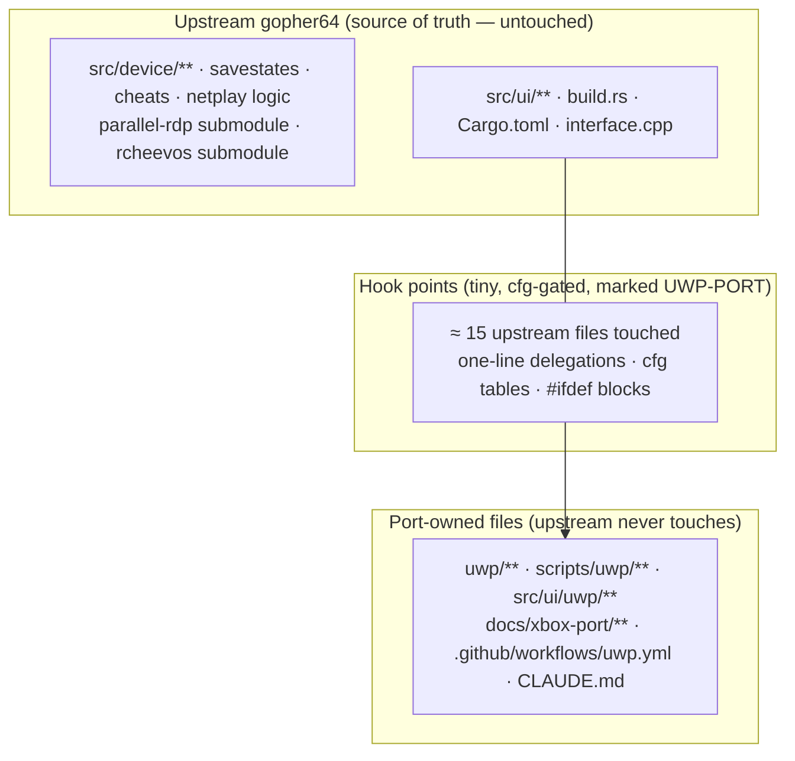

# 00 — Upstream Fidelity Rules (mandatory)

> **These rules override convenience.** Every change on `uwp/main` must follow them. If a task seems to require breaking a rule, stop and record a decision in [03-decisions.md](03-decisions.md) first.

## Why

The fork exists to run **upstream gopher64** on Xbox — not to become a different emulator. Upstream releases often (v1.1.42 at the time of writing, with several PRs per week). Every hour spent resolving merge conflicts is an hour not spent on the port. So the port must be an **additive layer** on top of upstream that can absorb any upstream release with a routine merge.



## The rules

### R1 — Upstream is the source of truth

- `main` is a **fast-forward-only mirror** of `upstream/main`. No port commit ever lands on `main`.
- When our code and upstream disagree, **upstream wins**. We adapt our hook, never upstream's logic.
- We do not "fix", refactor, rename, reorder, reformat or modernise upstream code on `uwp/main`. Bugs we find in upstream code are reported or fixed **upstream** (PR to `gopher64/gopher64`), then pulled in by a sync.

### R2 — New files over edits

Port code lives in files upstream will never touch:

| Location | Content |
|----------|---------|
| `uwp/**` | C++ host, manifest, assets, CMake, compat headers |
| `scripts/uwp/**` | build / package / deploy / audit scripts |
| `src/ui/uwp/**` | Rust UWP platform modules (entry point, dirs, audio FFI, `precise_sleep`, stubs). Note: `src/compat/` is **upstream-owned** (sse2neon, `aarch64.c`) — do not add files there |
| `docs/xbox-port/**` | This documentation |
| `.github/workflows/uwp.yml` | Fork-only CI |
| `CLAUDE.md` | Agent rules pointer (fork-only) |

If a new file needs to exist in an upstream directory, prefer a module file (`src/ui/uwp/mod.rs`) wired by **one** `mod` line over editing an existing file body.

### R3 — Edits to upstream files are hooks, not implementations

When an upstream file must change:

1. **Minimal hunk.** The upstream file gets a `cfg`/`#ifdef` gate and a one-line call into port-owned code. The logic lives in the port-owned file.
2. **Positive gating only.** Gate on `cfg(target_vendor = "uwp")` (Rust) / `#ifdef GOPHER64_UWP` (C/C++) / `CARGO_CFG_TARGET_VENDOR == "uwp"` (`build.rs`). Never change behaviour for desktop or Android, never use `not(uwp)` to *alter* upstream paths (only to *exclude* deps from UWP).
3. **Marker comment** on every hook so they can be listed with one grep:
   ```rust
   #[cfg(target_vendor = "uwp")] // UWP-PORT: storage root injected by host (D-10)
   return ui::uwp::dirs::get_dirs();
   ```
   ```cpp
   #ifdef GOPHER64_UWP // UWP-PORT: load Dozen directly (D-07)
     PFN_vkGetInstanceProcAddr gipa = g64_uwp_load_dozen();
   #else
   ```
   `git grep -n "UWP-PORT"` must list **every** change to upstream files.
4. **No interleaving.** Hook blocks are contiguous; never sprinkle `cfg` across many lines of an upstream function. If that seems necessary, the function needs a delegation point instead (and possibly an upstream PR adding one — R8).
5. **Formatting.** Format only the lines we touch. No `.clang-format` exists upstream → never run clang-format on upstream C/C++ files. Rust: upstream enforces `rustfmt` — our hunks must already be rustfmt-clean so `cargo fmt --check` produces no diff on upstream lines.

### R4 — Never modify submodules or vendored code

`parallel-rdp/parallel-rdp-standalone`, `retroachievements/rcheevos`, `src/compat/sse2neon`, `android-project/libadrenotools` stay at the commit upstream pins. Workarounds use force-included headers (`/FI uwp/compat/g64_uwp_compat.h`), wrappers, or patches proposed to the submodule's own upstream. Mesa/SDL changes go to **our forks of those projects**, not into gopher64.

### R5 — Desktop and Android must stay byte-for-byte equivalent in behaviour

On every commit to `uwp/main`, all upstream checks still pass unchanged:

```bash
cargo fmt --check
cargo clippy -- -Dwarnings
cargo clippy --no-default-features -- -Dwarnings
cargo build --release
```

Default features, CLI arguments, config schema, save formats and savestate formats are **not** changed. UWP must read and write the same `config.json`, save and state files as desktop (users can move saves between PC and Xbox).

### R6 — Dependencies follow upstream

- Never bump, downgrade or add features to an upstream dependency for the UWP build in the shared tables. UWP-only differences live in the `[target.'cfg(target_vendor = "uwp")'.dependencies]` table.
- When upstream bumps a crate that appears in our target tables, mirror the bump there in the same sync.
- `Cargo.lock`: on conflict take upstream's file, then let Cargo re-resolve our UWP-only crates (`cargo update -p <crate>`). Never hand-merge the lock file.
- `rust-toolchain.toml`: always upstream's. CI installs `rust-src` for whatever version it pins (D-03).

### R7 — Syncs are routine, frequent and merge-based

- Sync at least **weekly**, and immediately when upstream touches a hook file (see the inventory below) or bumps the parallel-rdp submodule.
- `main` ← fast-forward from `upstream/main`; `uwp/main` ← `git merge main`. **No rebases and no force-pushes** of `uwp/main` (history and tags stay valid).
- A sync is complete only when: R5 checks pass, the UWP build passes (`scripts/uwp/build.ps1`), the import audit passes, and — if parallel-rdp moved — the P0 Dozen regression on PC passes ([13](13-testing-debugging.md)).
- Conflict resolution order: (1) take upstream's version of the hunk, (2) re-apply our hook on top, (3) if the hook no longer fits, move the logic further into port-owned code rather than editing more upstream lines.

### R8 — Upstream-first for anything generic

If a change would make sense for upstream (Cargo features for netplay/discord, a sleep abstraction, a Vulkan-loader override hook, a `get_dirs` override), record it as an **upstreaming proposal** in [12 §4](12-upstream-sync.md#4-upstreaming-candidates). When upstream gains an equivalent, **delete our version** in the next sync. The goal over time is a shrinking hook inventory.

> ⚠ **Upstream contribution policy.** Upstream's README states: *"PRs that are vibe coded and/or co-authored by AI agents (Plan/Agent mode) are not permitted. If you are going to submit a PR, it should be scoped to a single feature/improvement."* Therefore agents **never** open PRs, issues or comments on `gopher64/gopher64`, and agent-written code is never submitted upstream. Any upstream contribution is written by hand by the fork maintainer, scoped to a single improvement.

### R9 — Commit hygiene

- Port commits are prefixed `uwp:` (e.g. `uwp: add XAudio2 backend`), sync merges are `Merge upstream vX.Y.Z (<short-sha>)`.
- A commit that touches an upstream file touches **only** the hook needed for its purpose, and its message names the decision (`D-xx`) it implements.
- No unrelated changes in sync merge commits.

### R10 — Keep the diff measurable

The upstream-file diff is tracked in the inventory below and checked on every sync:

```bash
# all changes to files that exist upstream (port-owned paths excluded)
git diff --stat main...uwp/main -- . \
  ':(exclude)uwp/**' ':(exclude)scripts/uwp/**' ':(exclude)src/ui/uwp/**' \
  ':(exclude)docs/xbox-port/**' \
  ':(exclude).github/workflows/uwp.yml' ':(exclude)CLAUDE.md'
git grep -n "UWP-PORT"
```

**Budget:** ≤ 20 upstream files touched and ≤ 400 changed lines in upstream files. Exceeding the budget requires a decision record explaining why.

### R11 — Machine-independent: no absolute paths

The repo must build and work the same on any machine with the workspace layout `<workspace>/gopher64` + sibling repos.

- Sibling repositories are referenced relative to the repo root: `../Ymir`, `../mesa-uwp`, `../SDL3-uwp`, `../meson-uwp`, … Never `D:\…` or any drive/user path.
- Tools are discovered at runtime (`vswhere`, `PATH`, `rustup`, `git rev-parse --show-toplevel`), not hard-coded.
- Machine-specific inputs come from environment variables (`GOPHER64_ROMS`, `XBOX_IP` in the git-ignored `scripts/uwp/xbox.env`) with documented defaults.
- Files that must contain absolute paths (Cargo `links` overrides in `.cargo/uwp-links.toml`, CMake caches, `out/`) are **generated** by scripts and **git-ignored**.
- Check: `git grep -nE '[A-Za-z]:[\\/]'` over port-owned files must return nothing except console-side examples (e.g. `E:\gopher64` drive probes) and documentation of standard install locations via environment variables.

## Hook inventory (planned — update as hooks land)

| Upstream file | Hook | Decision | Approx. lines |
|---------------|------|----------|---------------|
| `Cargo.toml` | Target-specific dependency tables | D-05, D-09, D-11, D-15 | ~40 |
| `.cargo/config.toml` | `[target.x86_64-uwp-windows-msvc]` section + target CC vars (appended at end) | D-03, D-14 | ~10 |
| `build.rs` | One `if uwp { … }` block: defines, no `-flto`, no winresource, `/FI` header | D-14 | ~20 |
| `src/lib.rs` | `#[cfg(target_vendor = "uwp")] mod` line for the UWP entry module | D-02 | ~2 |
| `src/ui.rs` | `mod uwp` line; `get_dirs()` delegation; `WEB_CLIENT` cfg widened to `any(android, uwp)`; extra hints | D-10, D-11, D-04 | ~15 |
| `src/ui/audio.rs` | Delegation to `ui::uwp::audio` per public fn | D-08 | ~25 |
| `src/ui/video.rs` | Window flags on UWP | D-04, D-07 | ~6 |
| `src/device/vi.rs` | `cfg`-gated call to `ui::uwp::time::precise_sleep` next to the untouched `spin_sleep::sleep` | 05 §4 | ~3 |
| `src/main.rs` | none (desktop only) | — | 0 |
| `src/netplay.rs`, `src/ui/netplay.rs` | `cfg` swap to stub module | D-09 | ~6 |
| `src/retroachievements.rs` | Discord calls gated | D-09 | ~8 |
| `src/ui/usb.rs` | Gated | D-09 | ~3 |
| `parallel-rdp/interface.cpp` | Dozen loader `#ifdef`; suspend-teardown guard | D-07, D-18 | ~20 |
| `parallel-rdp/wsi_platform.cpp` | UWP surface `#ifdef` | D-07 | ~25 |
| **Total** | **~14 files** | | **~180–250** |

## PR / commit checklist for `uwp/main`

- [ ] Logic lives in port-owned files; upstream files only received hooks
- [ ] Every upstream hook has a `UWP-PORT:` marker with a decision ID
- [ ] No submodule pointer changes except those coming from upstream
- [ ] No formatting/renaming/reordering of upstream code
- [ ] `cargo fmt --check`, both `cargo clippy … -Dwarnings`, `cargo build --release` pass
- [ ] UWP build + import audit pass
- [ ] Hook inventory above updated if an upstream file was touched
- [ ] Diff budget (R10) respected
