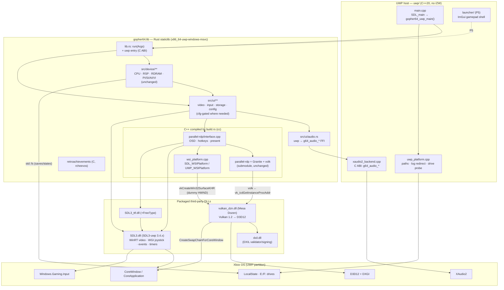
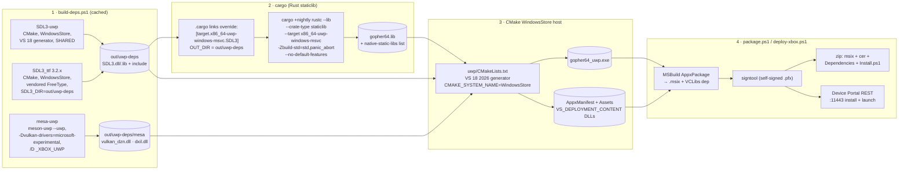
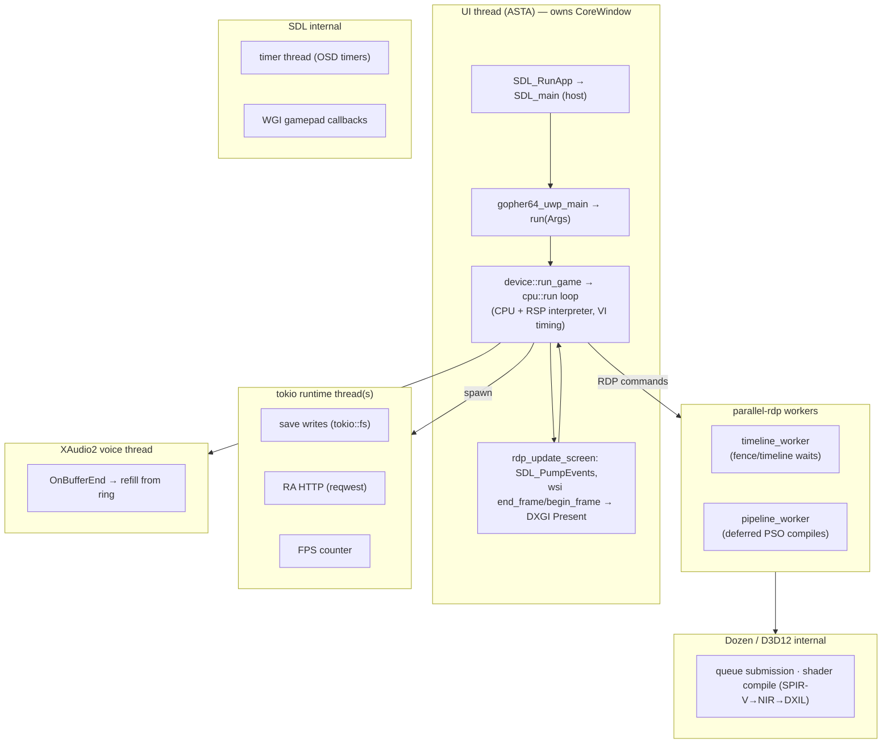
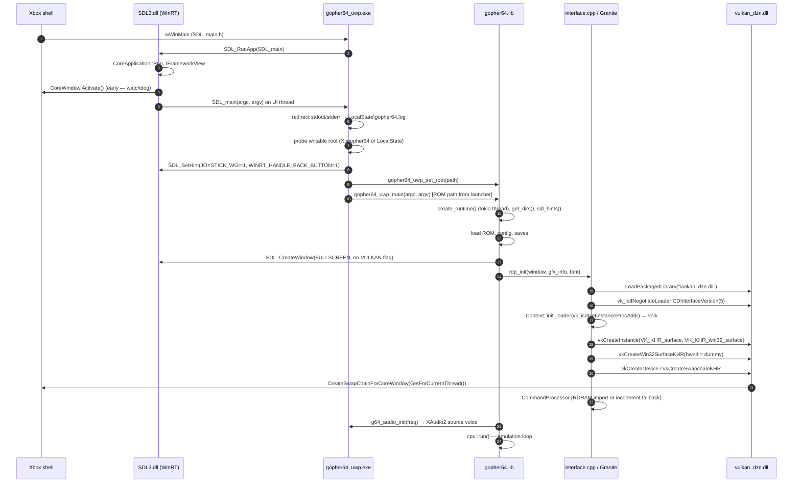
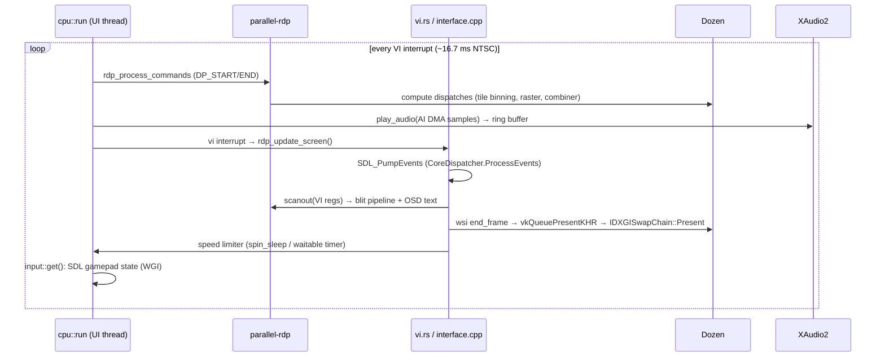

# 02 — Architecture

This document describes the target architecture of the UWP build. The guiding principle is **wrap, don't fork**: the emulator core, parallel-rdp and almost all of gopher64's Rust code compile unchanged. A thin C++ host owns the UWP entry point, and a few `cfg(target_vendor = "uwp")` branches replace desktop-only platform code.

## 1. Component view



### 1.1 Module disposition

| Module | Desktop | UWP | Change type |
|--------|---------|-----|-------------|
| `src/device/**` (CPU, RSP, RDP glue, PIF, carts) | ✔ | ✔ | **None** |
| `src/savestates.rs`, `src/cheats.rs` | ✔ | ✔ | None |
| `src/netplay.rs` + `src/ui/netplay.rs` | ✔ | ✘ | `cfg` stub (`Netplay` type kept, `init` returns `None`) |
| `src/retroachievements.rs` | ✔ | ✔ (P6) | Discord part gated; HTTP via reqwest/rustls/webpki-roots |
| `src/ui/gui.rs`, `gui/*.slint`, `cheats.rs`, `vru.rs` (gui feature) | ✔ | ✘ | Excluded by `--no-default-features` |
| `src/ui/video.rs` | SDL window + Vulkan flag | SDL window **without** `SDL_WINDOW_VULKAN`, always fullscreen | `cfg` branch |
| `parallel-rdp/interface.cpp` | `SDL_Vulkan_GetVkGetInstanceProcAddr` | Dozen GIPA via `LoadPackagedLibrary` | `#ifdef GOPHER64_UWP` |
| `parallel-rdp/wsi_platform.cpp` | `SDL_Vulkan_CreateSurface` | `vkCreateWin32SurfaceKHR` with dummy HWND | `#ifdef` / subclass |
| `src/ui/audio.rs` | SDL audio stream | XAudio2 via C ABI in the host | `cfg` branch |
| `src/ui/input.rs`, `input_profile.rs` | SDL gamepad/joystick | Same (WGI under the hood) + default Xbox profile | Hint + defaults |
| `src/ui.rs` `get_dirs()` | `dirs` crate / portable | Root path injected by the host | `cfg` branch |
| `src/ui.rs` `WEB_CLIENT` | rustls + platform verifier + system proxy | rustls + webpki-roots (Android path) | `cfg(any(android, uwp))` |
| `src/main.rs` | binary, mimalloc | Not used (staticlib entry instead) | None |
| `build.rs` | winresource, `-march`, LTO, git describe | Skip winresource; define `GOPHER64_UWP`, `WINAPI_FAMILY=WINAPI_FAMILY_APP` | Small `if target_vendor == "uwp"` |

## 2. Build pipeline



Notes:

- **Why `cargo rustc --crate-type staticlib`** instead of adding `staticlib` to `Cargo.toml`: keeps upstream's `crate-type = ["cdylib", "rlib"]` untouched (no extra artifact for desktop builds, no merge conflicts). `cargo rustc --crate-type` is stable.
- **Why the `links` override**: `sdl3-sys` declares `links = "SDL3"`, so Cargo lets `.cargo/config.toml` replace its build script output per target. Setting the `OUT_DIR` metadata key makes `DEP_SDL3_OUT_DIR` point at our prebuilt prefix, which is exactly what `build.rs:77` reads to find SDL headers. **Zero changes to `build.rs` for SDL include paths.** Same for `SDL3_ttf` (`links = "SDL3_ttf"`, `build.rs:80`).
- **Why the final link happens in CMake/MSBuild**, not cargo: the UWP CRT swap (`vccorlib.lib`, `msvcrt.lib`, `WindowsApp.lib`, `/APPCONTAINER`, `/NODEFAULTLIB:kernel32.lib …`) and appx packaging are solved problems in the VS generator (Ymir `UWPPackaging.cmake`). Cargo's link step is not involved for a staticlib.
- Details: [05 — Rust on UWP](05-rust-uwp-toolchain.md), [08 — Packaging](08-packaging-deploy.md).

## 3. Runtime view

### 3.1 Threads



**Decision ([D-06](03-decisions.md#d-06)): the emulator runs on the UI thread** for the first milestones. Reasons:

1. SDL3-uwp runs `SDL_main` on the UI (ASTA) thread — Ymir works this way at 60 fps.
2. Mesa's `uwp_get_window_reference()` caches `CoreWindow::GetForCurrentThread()` on first call (`mesa-uwp/src/util/uwp_util.cpp:25-31`); creating the swapchain on any other thread yields a null window and `CreateSwapChainForCoreWindow` fails.
3. gopher64 already pumps SDL events once per frame (`parallel-rdp/interface.cpp:735`), which drives `CoreDispatcher::ProcessEvents` inside SDL's WinRT event pump, so the window stays responsive.
4. gopher64 needs an 8 MiB stack (`.cargo/config.toml`: `/STACK:8388608`). The host exe sets `/STACK:8388608`; whether the UI thread honours the PE stack reserve under CoreApplication is **Q-01** (verify in P2; fallback below).

Fallback if Q-01 fails or UI-thread blocking causes lifecycle problems: patch mesa-uwp `uwp_get_corewindow()` to use `CoreApplication::MainView().CoreWindow()` (it already does that for the dispatcher in `uwp_get_width/height`), and move `run()` to a worker thread spawned with an explicit 8 MiB stack.

### 3.2 Boot sequence



### 3.3 Frame loop



## 4. Repository layout (planned additions)

```text
gopher64/
├─ docs/xbox-port/            ← this documentation
├─ uwp/                       ← NEW: UWP host project (never built by upstream CI)
│  ├─ CMakeLists.txt          WindowsStore project; links gopher64.lib + SDL3; packaging
│  ├─ UWPPackaging.cmake      adapted from Ymir
│  ├─ Package.appxmanifest.in
│  ├─ Assets/                 tiles, splash, store logo (full set — APPX1619 otherwise)
│  └─ src/
│     ├─ main.cpp             SDL_main → gopher64_uwp_main
│     ├─ uwp_platform.{hpp,cpp}  log redirect, root probe, UI helpers
│     ├─ xaudio2_backend.{hpp,cpp}  C ABI used by src/ui/audio.rs
│     └─ launcher/            (P5) ImGui shell, file browser
├─ scripts/uwp/               ← NEW: build-deps, build, package, deploy-xbox (from Ymir)
│  └─ xbox.env.example
├─ .cargo/config.toml         ← + [target.x86_64-uwp-windows-msvc] section & links overrides
├─ .github/workflows/uwp.yml  ← NEW (fork only)
├─ build.rs                   ← + small `target_vendor == "uwp"` block
├─ Cargo.toml                 ← + target-specific dependency tables
├─ parallel-rdp/interface.cpp ← + #ifdef GOPHER64_UWP loader branch
├─ parallel-rdp/wsi_platform.{hpp,cpp} ← + UWP surface creation
└─ src/
   ├─ lib.rs                  ← + uwp C-ABI entry module
   ├─ ui.rs                   ← get_dirs / WEB_CLIENT cfg branches
   ├─ ui/audio.rs             ← uwp branch → FFI
   ├─ ui/video.rs             ← uwp window flags
   └─ netplay.rs              ← cfg stub on uwp
```

## 5. On-device layout

### 5.1 Package (read-only install location on the console, `%ProgramFiles%\WindowsApps\<pkg>\` equivalent)

```text
gopher64_uwp.exe
gopher64_uwp.pri / resources.pri
AppxManifest.xml
Assets\*.png
SDL3.dll
SDL3_ttf.dll
vulkan_dzn.dll
dxil.dll
data\…                       (only if any runtime data is needed; fonts are embedded via include_bytes!)
```

### 5.2 Writable data (root chosen at startup)

```text
<root>\                      = X:\gopher64  (first writable external drive)  or  LocalState\gopher64
├─ config\
│  ├─ config.json            (src/ui/config.rs)
│  ├─ cheats.json
│  └─ retroachievements.json
├─ data\
│  ├─ saves\<name>-<hash>.{eep,sra,fla,mpk}
│  └─ states\<name>-<hash>.state<N>
├─ cache\
├─ roms\                     (suggested location; launcher browses any drive)
└─ logs\gopher64.log         (stdout/stderr redirected at fd level)
```

The three directories map 1:1 onto gopher64's existing `Dirs { config_dir, data_dir, cache_dir }` (`src/ui.rs:210-235`), so nothing downstream changes.
