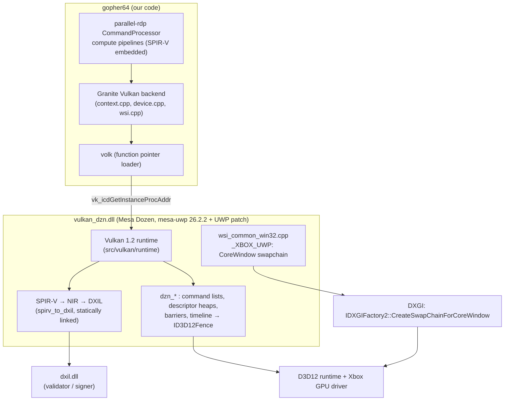
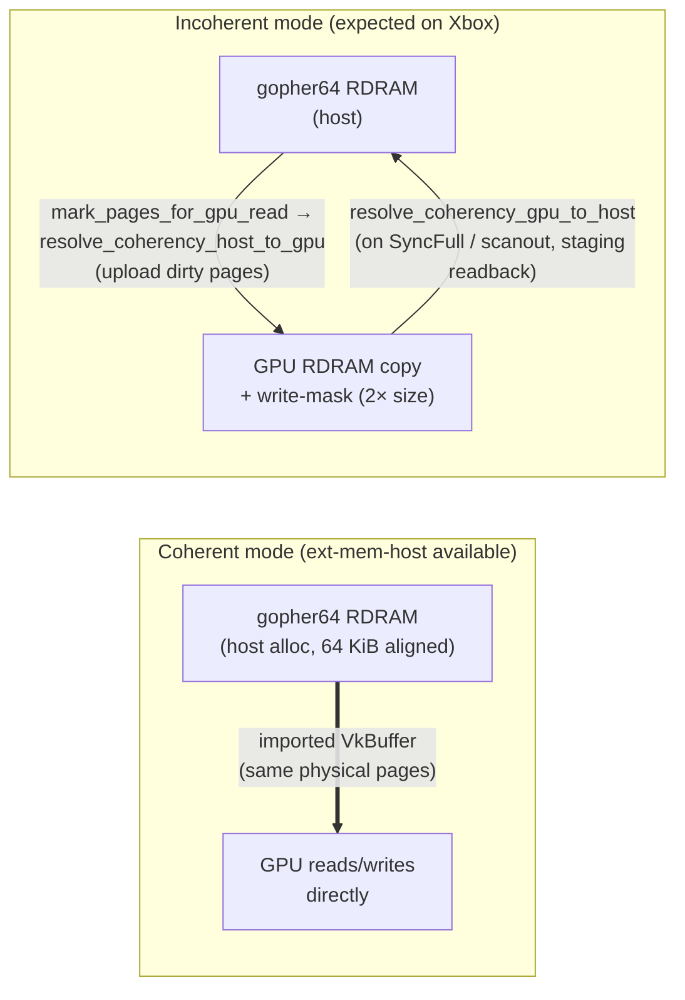
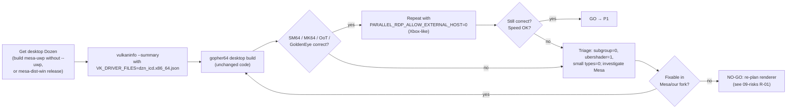

# 04 — Vulkan on Xbox via Mesa Dozen

This is the highest-risk part of the port. It explains what parallel-rdp actually needs, what Dozen provides, how we load it inside an AppContainer, and how we validate it before touching the console.

## 1. The stack



## 2. What parallel-rdp + Granite actually require

Verified in `parallel-rdp/parallel-rdp-standalone` at submodule commit `9ba7406d`.

### 2.1 Hard requirements (init fails without them)

| Requirement | Where enforced | Dozen |
|-------------|----------------|-------|
| Instance/device API ≥ 1.1 | `vulkan/context.cpp:571,918,1081-1088` | ✔ 1.2 (`dzn_device.c:61`, `DZN_API_VERSION`) |
| `VK_KHR_create_renderpass2` if device < 1.2 | `vulkan/context.cpp:1426-1432` | n/a (1.2 core) |
| A graphics queue (used for compute + present) | `vulkan/context.cpp:1193` | ✔ direct queue |
| `maxUniformBufferRange ≥ VULKAN_MAX_UBO_SIZE` | `vulkan/context.cpp:912` | ✔ (D3D12 CBV 64 KiB) — confirm in P0 log |
| `VK_KHR_swapchain` + a surface the GPU can present to | `vulkan/wsi.hpp:57-60`, `context.cpp:1005-1013` | ✔ via win32 surface (UWP-patched) |
| RDRAM buffer allocation succeeds (import or fallback) | `rdp_device.cpp:113-114,177-181` | ✔ fallback path always available |
| `storageBuffer8BitAccess` and `storageBuffer16BitAccess` | `rdp_renderer.cpp:168-177` | 8-bit storage is off by default; enable `dzn_enable_8bit_loads_stores` and verify both on Xbox |

### 2.2 Optional features (used when present, with a fallback)

| Feature | Used for | Fallback | Dozen exposure |
|---------|----------|----------|----------------|
| `VK_EXT_external_memory_host` | Import gopher64's RDRAM (`alloc_zeroed`, 64 KiB aligned, `src/device/rdram.rs:152-158`) directly into the GPU address space → zero-copy coherent RDRAM | **Incoherent mode**: GPU-side RDRAM copy (2× size, with write mask), page tracking and explicit host↔GPU resolves inside the renderer (`rdp_device.cpp:93-111`; `rdp_renderer.cpp:2991-3023`, `resolve_coherency_*`). Slower, functionally complete. | Only if `ID3D12Device13` is available (`dzn_device.c:149`, `OpenExistingHeapFromAddress1`). **Assume absent on Xbox.** |
| Timeline semaphores | Granite's internal sync; `CommandProcessor::signal_timeline/wait_for_timeline` | Granite falls back to binary semaphores/fences (`vulkan/device.cpp:94,147,1066-1068`) | ✔ always (`dzn_device.c:143,780`) |
| `shaderInt16` + `shaderInt8` arithmetic | "SMALL_TYPES" shader variants — more efficient | 32-bit arithmetic (`rdp_renderer.cpp:213-225`); 8/16-bit storage remains mandatory | Depends on D3D12 capabilities and `dzn_enable_8bit_loads_stores` |
| Subgroups: basic, vote, ballot, arithmetic in compute; min size 32 & ≤ 64 | Tile binning and depth-blend fast paths (`rdp_renderer.cpp:228-247`) | Non-subgroup shader variants | ✔ all four ops (`dzn_device.c:986-993`); `subgroupSize = WaveLaneCountMin` (RDNA2: 32 expected) |
| `VK_EXT_subgroup_size_control` | Force wave size for binning | Default size | ✔ if WaveOps + SM6.6 (`dzn_device.c:798`) |

**Correction, 2026-10-30:** Vulkan 1.1 compute and a swapchain alone are not sufficient: parallel-rdp explicitly requires both 8- and 16-bit storage buffer access. On desktop Dozen 26.2.6, the default 8-bit setting makes initialisation fail; enabling it exposes the feature, but does not by itself prove the renderer works. Xbox support remains unverified.

### 2.3 parallel-rdp environment knobs useful for testing

| Variable | Effect | Source |
|----------|--------|--------|
| `PARALLEL_RDP_ALLOW_EXTERNAL_HOST=0` | Force the incoherent RDRAM path (simulate "no ext-mem-host" on PC) | `rdp_device.cpp:77-79` |
| `PARALLEL_RDP_SUBGROUP=0` | Disable subgroup paths | `rdp_renderer.cpp:152-156` |
| `PARALLEL_RDP_UBERSHADER=1` | Use the ubershader (fewer pipeline variants → fewer DXIL compiles) | `rdp_renderer.cpp` `init_caps` |
| `PARALLEL_RDP_FORCE_SYNC_SHADER=1` | Synchronous shader compiles (debug stutter vs. correctness) | same |
| `PARALLEL_RDP_BENCH=1` | Timestamps per stage | same |
| `PARALLEL_RDP_SINGLE_THREADED_COMMAND=1` | Already set by gopher64 (`src/ui/video.rs:42`) | upstream #1303 |
| `RDP_DEBUG=1` | Debug channel | `rdp_renderer.cpp:85-86` |

> ⚠ Setting env vars for C/C++ code: Rust's `std::env::set_var` calls `SetEnvironmentVariableW`; UCRT's `getenv` reads the CRT's own environment table. On UWP, set variables needed by C/C++ (parallel-rdp, Mesa driconf) with `_putenv_s` from the host **before** `rdp_init` / `LoadPackagedLibrary`. (**Q-07**: confirm whether `set_var` is visible to parallel-rdp's `getenv` on UWP; it is used today by upstream for `PARALLEL_RDP_SINGLE_THREADED_COMMAND`.)

## 3. Loading Dozen inside the AppContainer

### 3.1 Why not the Khronos loader

The loader discovers ICDs via registry keys / `VK_DRIVER_FILES` and JSON manifests, then `LoadLibrary`s them. Inside an AppContainer on Xbox there is no driver registry entry, `LoadLibrary` of arbitrary paths is restricted, and the loader adds nothing (no layers needed in production). Mesa ICDs are self-sufficient: dispatchable handles carry `ICD_LOADER_MAGIC`, and `vk_icdGetInstanceProcAddr(NULL, "vkCreateInstance")` returns global commands. The same "load the ICD directly" technique is what `libadrenotools` does on Android, and gopher64 already supports a custom loader entry (`src/ui/video.rs:45-62`).

### 3.2 Exports (verified)

`dumpbin /exports` on the mesa-uwp-built `vulkan_dzn.dll` bundled in `RetroArch/pkg/msvc-uwp/RetroArch-msvcUWP/MESA/x64/` (RetroArch commit `68768fcff0`):

```text
vk_icdGetInstanceProcAddr
vk_icdGetPhysicalDeviceProcAddr
vk_icdNegotiateLoaderICDInterfaceVersion
```

`dumpbin /dependents`: `vccorlib140_app.dll`, `VCRUNTIME140_APP.dll`, `VCRUNTIME140_1_APP.dll`, `api-ms-win-crt-*`, `api-ms-win-core-*` only → a genuine App-CRT UWP binary. `spirv_to_dxil` is linked in statically; `d3d12.dll` and `dxil.dll` are loaded at runtime.

### 3.3 Code changes

`parallel-rdp/interface.cpp` (around line 430):

```cpp
#ifdef GOPHER64_UWP
#include <windows.h>
static PFN_vkGetInstanceProcAddr g64_load_dozen()
{
    static HMODULE dzn = LoadPackagedLibrary(L"vulkan_dzn.dll", 0);
    if (!dzn) { LOGE("LoadPackagedLibrary(vulkan_dzn.dll) failed: %lu\n", GetLastError()); return nullptr; }

    using PFN_negotiate = VkResult (VKAPI_PTR *)(uint32_t *);
    if (auto negotiate = reinterpret_cast<PFN_negotiate>(
            GetProcAddress(dzn, "vk_icdNegotiateLoaderICDInterfaceVersion"))) {
        uint32_t version = 5;           // loader/ICD interface v5 (ICD-created surfaces, 1.1+ apiVersion)
        negotiate(&version);
        LOGI("Dozen ICD interface version %u\n", version);
    }
    return reinterpret_cast<PFN_vkGetInstanceProcAddr>(
        GetProcAddress(dzn, "vk_icdGetInstanceProcAddr"));
}
#endif

  // ...
#ifdef GOPHER64_UWP
  PFN_vkGetInstanceProcAddr gipa = g64_load_dozen();
#else
  PFN_vkGetInstanceProcAddr gipa = (PFN_vkGetInstanceProcAddr)SDL_Vulkan_GetVkGetInstanceProcAddr();
#endif
  if (!gipa || !::Vulkan::Context::init_loader(gipa)) { /* existing error path */ }
```

`parallel-rdp/wsi_platform.cpp`:

```cpp
#ifdef GOPHER64_UWP
#include <vulkan/vulkan_win32.h>   // VK_USE_PLATFORM_WIN32_KHR is already defined by build.rs
VkSurfaceKHR SDL_WSIPlatform::create_surface(VkInstance instance, VkPhysicalDevice) {
  VkWin32SurfaceCreateInfoKHR info = { VK_STRUCTURE_TYPE_WIN32_SURFACE_CREATE_INFO_KHR };
  info.hinstance = GetModuleHandleW(nullptr);
  info.hwnd = reinterpret_cast<HWND>(static_cast<uintptr_t>(1)); // ignored by mesa-uwp (_XBOX_UWP)
  VkSurfaceKHR surface = VK_NULL_HANDLE;
  surface_valid = vkCreateWin32SurfaceKHR(instance, &info, nullptr, &surface) == VK_SUCCESS;
  return surface;
}
void SDL_WSIPlatform::destroy_surface(VkInstance instance, VkSurfaceKHR surface) {
  surface_valid = false;
  vkDestroySurfaceKHR(instance, surface, nullptr);
}
std::vector<const char *> SDL_WSIPlatform::get_instance_extensions() {
  return { VK_KHR_SURFACE_EXTENSION_NAME, VK_KHR_WIN32_SURFACE_EXTENSION_NAME };
}
#else
// existing SDL_Vulkan_* implementation
#endif
```

`src/ui/video.rs` (line 66): on UWP build `flags` without `SDL_WINDOW_VULKAN` — SDL3-uwp's `SDL_CreateWindow` returns an error when the flag is set because the WinRT driver has no `Vulkan_CreateSurface` (`SDL3-uwp/src/video/SDL_video.c:2678`). Always add `SDL_WINDOW_FULLSCREEN`.

### 3.4 Mesa's CoreWindow lookup — thread affinity

```cpp
// mesa-uwp/src/util/uwp_util.cpp:25-31
static CoreWindow uwp_get_corewindow() {
   if (!_uwpCoreWind) _uwpCoreWind = CoreWindow::GetForCurrentThread();   // cached forever
   return _uwpCoreWind;
}
```

`uwp_get_window_reference()` is **not exported** from `vulkan_dzn.dll`, so the cache is primed on the first `vkCreateSwapchainKHR`. That call must run on the UI thread ([D-06](03-decisions.md#d-06)). If we ever move emulation off the UI thread, patch our mesa-uwp fork:

```cpp
_uwpCoreWind = CoreWindow::GetForCurrentThread();
if (!_uwpCoreWind) _uwpCoreWind = CoreApplication::MainView().CoreWindow();
```

(`uwp_get_width/height` already marshal through `MainView().CoreWindow().Dispatcher()`.)

### 3.5 Swapchain details on UWP

| Aspect | Mesa behaviour (`wsi_common_win32.cpp`) | Implication |
|--------|------------------------------------------|-------------|
| `currentExtent` | `uwp_get_width()/height()` = HDMI display mode (e.g. 3840×2160) (`:210-213`) | Granite sizes the swapchain from `get_surface_width/height` → SDL's `SDL_GetWindowSizeInPixels` (SDL3-uwp reports the TV output since `4df9707d5`). If they disagree, prefer Mesa's extent (**Q-08**). |
| Present modes | DXGI list: IMMEDIATE, MAILBOX, FIFO (`:402-407`) | gopher64 requests MAILBOX→FIFO with vsync, MAILBOX→IMMEDIATE without. |
| IMMEDIATE | uses `DXGI_SWAP_CHAIN_FLAG_ALLOW_TEARING` (`:906`) | Ymir D18 found tearing must stay off on Xbox → force vsync on UWP (MAILBOX/FIFO only). |
| Swap effect | `FLIP_SEQUENTIAL`, `DXGI_SCALING_STRETCH` (`:900-905`) | Matches Ymir D18. |
| DirectComposition | compiled out | — |

### 3.6 Mesa patch plan for our mesa-uwp fork

Base: **SternXD `mesa-uwp` 26.2.2** (`34732bbc207`, already has the CoreWindow WSI and UWP build) — [D-17](03-decisions.md#d-17). On top of it we port the Xbox-hardening patches that shipped projects needed ([11 §1.3](11-prior-art.md#13-xbox-specific-dozen-problems-they-hit-and-fixed)). Patches are kept as a numbered series in our fork (`gopher64/dzn-xbox` branch) so they can be rebased onto newer Mesa.

| # | Patch | Origin | Why | Priority |
|---|-------|--------|-----|----------|
| M-01 | Write-combined memory for host-visible non-cached types on Xbox | OnyxEMU `0014` | CPU writes through WRITE_BACK mappings do not reach the GPU on Series → black frames. parallel-rdp's incoherent path uploads through host-visible staging. | **Critical (P3)** |
| M-02 | DXIL validator without `dxcompiler.dll` + optional self-signing; validate only the first N modules | OnyxEMU `0008`, `0016`; WWHD (validator target 1.7) | Series S validator refuses Dozen DXIL → pipelines fail | **Critical (P3)** |
| M-03 | Avoid calls the Xbox runtime removes the device for (out-of-family views → null descriptor, integer-texture sampling → fetch, `DENY_SHADER_RESOURCE`) | OnyxEMU `0011` | Device removed | High |
| M-04 | Fewer stalls: compile common variants at pipeline creation, no forced dedicated allocations, reuse upload buffers, rate-limit `GetDeviceRemovedReason` | OnyxEMU `0017` | 0.4–0.7 s PSO compiles freeze frames; kernel calls per allocation | High |
| M-05 | D3D12 pipeline library as persistent PSO cache (path from env / host) | OnyxEMU `0025`–`0028`; Bloodborne `driver.vkcache` | Startup + first-encounter stutter | High |
| M-06 | Application log hook (`*_set_log_hook`) + name the call after which the device was removed | OnyxEMU `0005`–`0007`, `0010`, `0012`, `0022`, `0024` | Diagnosability without a debugger | High |
| M-07 | Descriptor pool heap sizing | OnyxEMU `0009`, `0020` | Heap limits | Medium |
| M-08 | Fence value checks while waiting | OnyxEMU `0019` | Robust timeline waits | Medium |
| M-09 | Enable `dzn_enable_8bit_loads_stores`; consider 8/16-bit storage without native 16-bit ops + narrow subgroup lowering | own; idea from `Cosmo/mesa_ai_slop_version` (unlicensed — reimplement, don't copy) | 8-bit storage is required for parallel-rdp initialisation | **Critical (P3)** |
| M-10 | CoreWindow lookup fallback to `MainView()` | own | Worker-thread swapchain creation | Low (only if D-06 changes) |
| M-11 | Xbox D3D12 quirks found in P3 (e.g. typed UAV loads for 32 bpp formats — Azahar's `azahar-xbox-uav-cast.patch`) | as discovered | Correctness | As needed |

Before porting, diff mesa-uwp's UWP commit `34732bbc207` against OnyxEMU `0001`/`0002`/`0004`/`0029` (both make Dozen build for UWP; OnyxEMU's also routes `DXIL.dll` through `LoadPackagedLibrary` and avoids dbghelp/console lookups) and take the union.

**Where gopher64 itself writes GPU memory from the CPU (M-01 exposure):** gopher64 creates the command processor with `COMMAND_PROCESSOR_FLAG_HOST_VISIBLE_HIDDEN_RDRAM_BIT | COMMAND_PROCESSOR_FLAG_HOST_VISIBLE_TMEM_BIT` (`parallel-rdp/interface.cpp:339-342`) and keeps raw pointers to both buffers (`get_tmem()`, `begin_read_hidden_rdram()`, `:360-367`). They are used for **save states**: `memcpy` out on save (`:783-790`) and `memcpy` **in** on load (`:807-814`). parallel-rdp also clears them with `memset` through the mapping (`rdp_device.cpp:245-260`). These CPU writes go through host-coherent mappings — exactly the pattern OnyxEMU found invisible to the GPU on Xbox Series. Therefore:

- The flags cannot simply be dropped (savestates need the pointers).
- M-01 (write-combined host-visible memory) is required, **or** on UWP the savestate load path must upload TMEM/hidden RDRAM through a staging buffer + `vkCmdCopyBuffer` instead of `memcpy` into the mapping.
- Test case for P3/P4: save state → load state → compare the next frame with the frame produced before saving.

RDRAM in incoherent mode is affected too, in the host→GPU direction:

- **Host → GPU:** `resolve_coherency_host_to_gpu` (`rdp_renderer.cpp:2782-2830`) `memcpy`s dirty pages either straight into the mapped GPU RDRAM buffer (when it is host-visible — likely on a UMA console) or into `incoherent.staging_rdram` (`BufferDomain::Host`, `rdp_renderer.cpp:611-625`) followed by a GPU copy. Both are CPU writes into host-visible memory → **without M-01 the GPU would see stale/black RDRAM**. M-01 is therefore a P3 blocker, not an optimisation.
- **GPU → host:** readback uses `incoherent.staging_readback` (`CachedCoherentHostPreferCached`, i.e. WRITE_BACK cached — the type OnyxEMU keeps for readback) and the timeline worker copies it into host RDRAM **before** the timeline value is signalled (`rdp_device.cpp:1256-1283`). gopher64's lazy sync (`rdp_check_framebuffers` → `wait_for_timeline`, `interface.cpp:754-772`) keeps working unchanged.

### 3.7 Presentation strategy

| Option | Description | When |
|--------|-------------|------|
| **A (primary)** | Granite WSI → `vkCreateWin32SurfaceKHR` (dummy HWND) → mesa-uwp `_XBOX_UWP` WSI → `CreateSwapChainForCoreWindow` | P3 default — zero app-side D3D code |
| **B (fallback)** | Granite external swapchain (`WSIPlatform::has_external_swapchain()`, `init_external_swapchain`) rendering into images exported with `VK_KHR_external_memory_win32` + shared timeline semaphore; a small D3D12 presenter in the host opens them (`OpenSharedHandle`) and presents to a CoreWindow flip-model swapchain | If A shows pacing/tearing/HDR/lifecycle problems; this is what OnyxEMU, gow3 and Bloodborne do |
| **C (debug)** | CPU readback of the final frame into an SDL texture (`SDL_Renderer` D3D11) | Bring-up aid only; also proves the RDP works independently of WSI |

Granite already supports B: `vulkan/context.cpp:1381-1393` enables `VK_KHR_external_{semaphore,memory}_win32` when available, and `memory_allocator.cpp:77-78,688-689` / `semaphore.cpp:144-197` implement Win32 handle export/import.

## 4. RDRAM coherency in detail



- In incoherent mode, parallel-rdp itself tracks which pages the RDP will read (uploads them before a render pass) and which it wrote (reads them back at sync points and before VI scanout — `rdp_device.cpp:1118-1129`). gopher64 does **not** need to call `begin_read_rdram`/`end_write_rdram`; those exist for frontends that want direct mapped access.
- Cost: extra copies per frame proportional to the framebuffer/texture pages touched (typically a few hundred KiB to a few MiB per frame). On a UMA console with host-visible device memory this is cheap. If Dozen reports `VK_PHYSICAL_DEVICE_TYPE_INTEGRATED_GPU` (UMA), parallel-rdp places the GPU copy in `CachedCoherentHostPreferCached` memory (`rdp_device.cpp:104-107`) — **Q-09**: which device type does Dozen report on Xbox?
- Games that read back the framebuffer with the CPU (e.g. some effects in Zelda/Banjo) will exercise the GPU→host path more often; this is where incoherent-mode bugs, if any, would show.

## 5. Shader compilation

parallel-rdp ships SPIR-V embedded in the binary (no `PARALLEL_RDP_SHADER_DIR`), and creates many specialised compute pipelines (combiner/blender/raster variants, specialisation constants) lazily via `pipeline_worker`. On Dozen every pipeline creation runs SPIR-V → NIR → DXIL → (validated/signed by `dxil.dll`) → D3D12 PSO. On a desktop that costs milliseconds; **on Xbox the driver PSO compile alone takes 0.4–0.7 s** (OnyxEMU `0017`).

Mitigations, in order:
1. Keep async pipeline compiles (default) so gameplay does not block — expect first-encounter stutter; compute pipelines have no draw-time variants, so OnyxEMU's "variant at first draw" problem should not apply to parallel-rdp (verify in P3).
2. Persist compiled PSOs with a D3D12 pipeline library (M-05) under `{root}\cache\dzn`.
3. Persist the Mesa disk cache (NIR/DXIL) under `{root}\cache\mesa`.
4. Warm-up: on first boot, show "Compiling shaders…" while forcing creation of the common variant set (parallel-rdp can be driven with a recorded command dump; `rdp_dump_write.cpp` is already compiled in).
5. Fallback: `PARALLEL_RDP_UBERSHADER=1` to reduce the number of variants (slower per-dispatch but far fewer compiles).

Dolphin on Xbox limits shader compiler threads to 2 because of driver issues — if we see hangs during compile storms, limit `pipeline_worker` parallelism.

## 6. Startup diagnostics to log (always, on every boot)

Logged to `{root}\logs\gopher64.log` after device creation:

- Dozen ICD interface version, `VkPhysicalDeviceProperties` (`apiVersion`, `driverVersion`, `deviceType`, `deviceName`), `VkPhysicalDeviceDriverProperties` (`driverID` = `MESA_DOZEN`, `driverInfo`).
- `vk11_props.subgroupSize`, `subgroupSupportedOperations`, `subgroupSupportedStages`.
- `shaderInt16`, `shaderInt8`, `storageBuffer8BitAccess`, `storageBuffer16BitAccess`, `timelineSemaphore`.
- `supports_external_memory_host`, `minImportedHostPointerAlignment`.
- Memory heaps/types (size, flags) — tells us UMA vs not and how much device-local memory we really get in Game mode.
- parallel-rdp caps chosen: `supports_small_integer_arithmetic`, `subgroup_tile_binning`, `subgroup_depth_blend`, `ubershader`, coherent vs incoherent RDRAM.
- Swapchain: extent, format, present mode, image count.

## 7. P0 — validating Dozen on a Windows PC (before any Xbox work)

**2026-10-30 result:** SM64 rendered correctly on NVIDIA with mesa-dist-win
Dozen 26.2.4, required 8-bit storage enabled, `ALLOW_EXTERNAL_HOST=0`,
`SINGLE_THREADED_COMMAND=1` and `UBERSHADER=1` set before launch. The default
split renderer was corrupted. Ubershader passed 237 reduced RDP suites on NVIDIA,
but Intel gameplay remained corrupted. Root cause and performance are unverified;
see [checkpoint and reproduction](14-p0-handoff.md).

The renderer's basic Dozen compatibility can be tested on a desktop: the desktop build already loads Vulkan through `SDL_Vulkan_LoadLibrary` → `vulkan-1.dll` (the Khronos loader), which honours `VK_DRIVER_FILES`. This does not retire the Xbox-specific risks listed below.



Commands (PowerShell, from the repo root). Machine-specific locations come from environment variables, never hard-coded paths: `GOPHER64_ROMS` = your ROM folder; the desktop Dozen build/extract goes to `out\dzn-desktop\` (exclude it locally or use an isolated temporary directory).

Before running games, use an isolated copy of the executable with a `portable.txt` file beside it. Otherwise gopher64 uses the user's normal config and save directories. Copy only test saves into the isolated directory if needed.

```powershell
# 1. Point the Khronos loader at Dozen only
$env:VK_DRIVER_FILES = (Resolve-Path "out\dzn-desktop\share\vulkan\icd.d\dzn_icd.x86_64.json").Path
$env:VK_LOADER_DEBUG = "driver"          # optional: confirm dzn is the only driver
$env:dzn_enable_8bit_loads_stores = "true" # required by parallel-rdp
vulkaninfo --summary                      # expect: deviceName "Microsoft Direct3D12 (<GPU>)", driverID MESA_DOZEN

# 2. Run gopher64 (desktop build, no code change)
cargo run --release -- "$env:GOPHER64_ROMS\Super Mario 64 (U).z64"

# 3. Xbox-like RDRAM path
$env:PARALLEL_RDP_ALLOW_EXTERNAL_HOST = "0"
cargo run --release -- "$env:GOPHER64_ROMS\Super Mario 64 (U).z64"

# 4. Variants for triage
$env:PARALLEL_RDP_SUBGROUP = "0"
$env:PARALLEL_RDP_UBERSHADER = "1"
```

Record results in [13 — Testing](13-testing-debugging.md#p0-results). Note the PC GPU vendor: Dozen on an AMD RDNA desktop GPU is the closest proxy for the Series GPU; NVIDIA/Intel results are still useful for functional correctness.

**What P0 cannot prove.** Desktop D3D12 drivers do not reproduce three Xbox behaviours that shipped projects hit: CPU writes through WRITE_BACK mappings being invisible to the GPU (M-01), the stricter DXIL validator on Series S (M-02), and device removal on out-of-family views (M-03). P0 proves parallel-rdp **logic** on Dozen; P3 begins with console smoke tests for exactly these three ([10 — P3](10-roadmap-checklist.md#p3)).

## 8. Lessons adopted from shipped Dozen-on-Xbox projects

| Lesson | Source | Where applied |
|--------|--------|---------------|
| Load the ICD directly, negotiate interface v5 first | OnyxEMU, rpcs3-xbox, gow3 | §3.3 (our code matches OnyxEMU's `DozenDriver::Load`) |
| Hook Mesa logging into the app log before instance creation | OnyxEMU `0005`–`0007` | M-06, [06 §6](06-platform-layer.md#6-logging--crash-capture) |
| Write-combined memory for CPU-written data | OnyxEMU `0014` | M-01 (blocker) |
| Self-sign DXIL / relax validator | OnyxEMU `0008`/`0016`, WWHD | M-02 (blocker on Series S) |
| PSO compile ≈ 0.4–0.7 s on Xbox → pipeline library cache, warm-up | OnyxEMU `0017`, `0025`–`0028`; Bloodborne | M-04, M-05, §5 |
| Avoid "Out of host memory" / device-removed: check GPU memory budget, log allocations | rpcs3-xbox, OnyxEMU `0023` | §6 diagnostics, R-12 |
| Series S is the stricter/smaller target — test it early | OnyxEMU (device loss on Series S in v2.0), Bloodborne | [13](13-testing-debugging.md) test matrix |
| Expose a debug toggle file in LocalState (`dzn-debug.txt`) | WWHD | `{root}\config\dzn-debug.txt` → `DZN_DEBUG` via `_putenv_s` before load |
