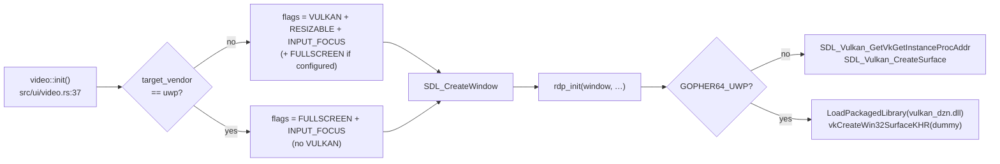
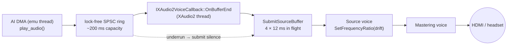
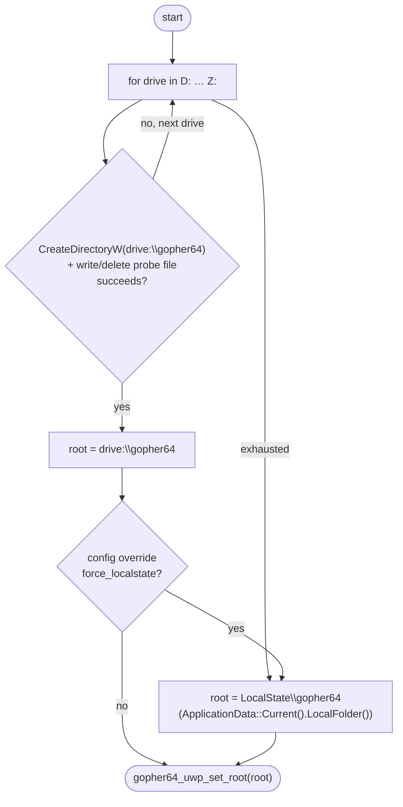

# 06 — Platform Layer

Everything between gopher64's portable code and the Xbox OS: SDL3-uwp, window, audio, input, storage, logging, lifecycle, timing.

## 1. SDL3-uwp

| Item | Value |
|------|-------|
| Repo | `SternXD/SDL3-uwp`, branch `uwp-3.4.16` (workspace: `SDL3-uwp`) |
| Commits on top of upstream 3.4.16 | `7a7e54b5d` consolidated UWP backend (core/winrt, video/winrt, WASAPI-WinRT, filesystem/locale/misc/power/main winrt, WinRT D3D11/D3D12 renderers) · `4df9707d5` Xbox TV output size via `GetWindowSize` · `ddd5d4f99` minimal picker (VisualC project only) |
| Build | CMake, `-G "Visual Studio 18 2026" -A x64 -DCMAKE_SYSTEM_NAME=WindowsStore -DCMAKE_SYSTEM_VERSION=10.0 -DSDL_SHARED=ON -DSDL_STATIC=OFF -DSDL_TESTS=OFF -DSDL_EXAMPLES=OFF -DSDL_TEST_LIBRARY=OFF` (Ymir `scripts/uwp/build-deps.ps1:46-62`) |
| Entry | `include/SDL3/SDL_main_impl.h`: `WinMain → SDL_RunApp(0, NULL, SDL_main, NULL)` → `Windows::Foundation::Initialize` + `SDL_WinRTInitNonXAMLApp` (`src/main/winrt/SDL_sysmain_runapp.cpp`); `/ZW` not required when `_MSVC_LANG >= 202002L` |
| Joystick | WGI only (`SDL_JOYSTICK_WGI 1`; XInput, HIDAPI off). **Opt-in hint at runtime.** |
| Vulkan | Not implemented in `src/video/winrt/` (no `Vulkan_LoadLibrary`, no `Vulkan_CreateSurface`). `SDL_WINDOW_VULKAN` → `SDL_CreateWindow` fails (`src/video/SDL_video.c:2678`). |
| CoreWindow access | `SDL_GetPointerProperty(SDL_GetWindowProperties(w), SDL_PROP_WINDOW_WINRT_WINDOW_POINTER, NULL)` (`include/SDL3/SDL_video.h:1658`) |

### 1.1 SDL3_ttf

`sdl3-ttf-sys 0.7.1` bundles SDL_ttf 3.2.2 sources (`sdl3-ttf-src 3.2.3` crate). We build SDL_ttf **3.2.x** as a DLL with CMake against the installed SDL3-uwp (`-DSDL3_DIR=out/uwp-deps/cmake`, `-DSDLTTF_VENDORED=ON -DSDLTTF_HARFBUZZ=OFF -DSDLTTF_PLUTOSVG=OFF`, `CMAKE_SYSTEM_NAME=WindowsStore`). FreeType is pure C and builds in the App partition. Used only for OSD text (`TTF_RenderText_LCD_Wrapped`, `interface.cpp:373-392`) and the input-profile configurator.

### 1.2 Hints set on UWP (in `src/ui.rs::sdl_hints()` and the host)

| Hint | Value | Why |
|------|-------|-----|
| `SDL_HINT_JOYSTICK_WGI` | `"1"` | Otherwise zero controllers enumerate (Ymir commit `1f098a91`) |
| `SDL_HINT_WINRT_HANDLE_BACK_BUTTON` | `"1"` | B/back must not close the app |
| existing gopher64 hints | unchanged | `src/ui.rs:156-175` |

## 2. Window & video



- **Resolution:** the swapchain uses the HDMI output size (Mesa `uwp_get_width/height`); parallel-rdp renders at N64 resolution × upscale factor and the final blit scales to the swapchain. Upscaling (`--upscale 2/4/8` equivalents in config) is a P6 performance knob.
- **Safe area:** use full CoreWindow bounds (Ymir `UseFullCoreWindowBounds()` — `ApplicationView::SetDesiredBoundsMode(UseCoreWindow)`), otherwise the Xbox shell applies TV-safe margins.
- **Vsync:** force on (MAILBOX/FIFO) — tearing flag unsupported on Xbox ([04 §3.5](04-vulkan-dozen.md#35-swapchain-details-on-uwp)).
- **Cursor:** `SDL_HideCursor` is called by `video.rs`; on Xbox `SDL_SetCursor` throws `0x80070714` (Ymir). Verify `SDL_HideCursor` is harmless (**Q-12**); if not, skip on UWP.

## 3. Audio — XAudio2

### 3.1 gopher64's audio contract today (`src/ui/audio.rs`)

| Function | SDL implementation | XAudio2 equivalent |
|----------|-------------------|--------------------|
| `init` | `SDL_InitSubSystem(AUDIO)` | `XAudio2Create`, `CreateMasteringVoice` |
| `init_game_audio` | `SDL_OpenAudioDeviceStream(S16LE, 2 ch, AI freq, callback)` | `CreateSourceVoice(WAVEFORMATEX{PCM,2,freq,16})`, start |
| `play_audio(dram_addr, length)` | `SDL_PutAudioStreamData` after N64 sample swap | push to ring; submit 12 ms buffers |
| `update_freq` (drift) | `SDL_SetAudioStreamFrequencyRatio(stream, ratio)` | `IXAudio2SourceVoice::SetFrequencyRatio(ratio)` |
| queued bytes (for drift control) | `SDL_GetAudioStreamQueued` | ring fill + `GetState().BuffersQueued × buffer_bytes` |
| `pause/resume_game_audio` | `SDL_PauseAudioStreamDevice` / `Resume…` | `Stop()` / `Start()` |
| `lower/raise_audio_volume` | `SDL_SetAudioStreamGain` | `SetVolume` |
| `close*` | destroy stream | `DestroyVoice`, release |

### 3.2 C ABI (host → Rust)

```c
// uwp/src/xaudio2_backend.h
int      g64_audio_init(void);
int      g64_audio_open(uint32_t sample_rate);            // S16 stereo
void     g64_audio_queue(const int16_t *frames, uint32_t frame_count);
uint32_t g64_audio_queued_bytes(void);
void     g64_audio_set_ratio(float ratio);
void     g64_audio_set_volume(float gain);
void     g64_audio_pause(int paused);
void     g64_audio_close(void);
```

### 3.3 Design



- Start from Ymir's `apps/ymir-sdl3/src/app/xaudio2_backend.cpp` (259 lines).
- 4 × 12 ms in flight is the stability floor measured in dosbox-pure-uwp; tune in P4.
- Keep gopher64's existing drift-control math (it targets a queue fill level and adjusts the ratio) — only the sink changes.

## 4. Input

- SDL gamepad API works unchanged on top of WGI once the hint is set. GUIDs, `SDL_OpenGamepad`, axes, buttons, rumble (`SDL_RumbleGamepad`, `src/ui/input.rs:216`) are all supported by SDL's WGI driver.
- **Default profile on UWP:** if no profile is bound to port 1, bind the built-in default gamepad profile (`input_profile.rs` default with `HOTKEY = BACK` at `:932-938`) to the first connected controller. Keyboard bindings are irrelevant on Xbox.
- **Hotkeys** (already implemented for gamepads, `src/ui/input.rs:351-400`): hold **View (Back)** + button:

| Combo | Action | `event.user.code` |
|-------|--------|-------------------|
| View + (button mapped to N64 R / save) | Save state | 1 |
| View + (load) | Load state | 2 |
| View + Start | Exit game (→ launcher in P5) | 3 |
| View + (fast-forward) | Fast forward | 4 |
| View + C-Left | Rewind | 5 |

  Exact button mapping is documented in-app in P5. Keyboard-only hotkeys from `sdl_event_filter` (F1 FPS, F4 crop, F12 reset, `[`/`]` volume, Alt+0-9 slot) need gamepad equivalents or launcher-menu entries (P4/P5).
- The **Xbox (Guide) button** is reserved by the system and never reaches the app.
- **Input profile configurator** (`--configure-input-profile`) opens an SDL renderer window — works in principle; superseded by the launcher's input page in P5.

## 5. Storage

### 5.1 Root selection (host, at startup)



- Probe with a real write (Ymir `FindExternalProfilePath()` pattern) — read-only mounts and the system drives fail cleanly.
- Use `*FromApp` APIs (`CreateDirectoryFromAppW`, `CreateFile2FromAppW`, `FindFirstFileExFromAppW`) in host C++ code; Rust `std::fs` works under `broadFileSystemAccess` + `runFullTrust` (Ymir, dosbox-pure, scummvm precedent).
- Never use `StorageFolder` for arbitrary drive paths (silently fails / AccessDenied on Xbox).

### 5.2 What gopher64 stores

| Path | Written by | When |
|------|-----------|------|
| `config/config.json` | `src/ui/config.rs:98-146` | on change / exit |
| `config/cheats.json`, `config/retroachievements.json` | config / RA | on change |
| `data/saves/<name>-<hash>.{eep,sra,fla,mpk}` | `src/ui/storage.rs:150-209,400-504` via `tokio::fs::write` | pending-write flags → async write |
| `data/states/<name>-<hash>.state<N>` | `src/savestates.rs` | on hotkey |
| `cache/` (+ `cache/mesa` for the shader cache) | gopher64 / Mesa | runtime |

## 6. Logging & crash capture

1. **Host:** before anything else, redirect fd 1/2 at the descriptor level to `{LocalState}\gopher64.log` (later moved to `{root}\logs\`): `_wfreopen` is **not** used (Ymir D21: the CRT closes the stream on failure); use `CreateFile2FromAppW` + `_open_osfhandle` + `_dup2`.
2. **No `OutputDebugString`** in release paths (raises without a debugger, scummvm-uwp `docs/XBOX-TILE-LAUNCH-KILL.md`). Install a vectored exception handler that swallows `DBG_PRINTEXCEPTION_C` (`0x40010006`) / `DBG_PRINTEXCEPTION_WIDE_C` (`0x4001000A`) in case a dependency calls it.
3. **Rust:** `std::panic::set_hook` writes `panic info + location` to stderr (→ log), then `panic=abort`.
4. **Unhandled SEH:** `SetUnhandledExceptionFilter` → write exception code + address + module base to the log.
5. Log rotation: keep `gopher64.log` + `gopher64.prev.log`.
6. Optional (debug builds): TCP log sidecar on ports 9000-9009 (`uwp-xray-depot`, dosbox-pure-uwp), requires loopback exemption.

## 7. Lifecycle

| UWP event | SDL3-uwp event | gopher64 today (`interface.cpp`) | UWP behaviour we want |
|-----------|----------------|-----------------------------------|-----------------------|
| Activated | — | — | CoreWindow activated **early** by SDL (watchdog) |
| Suspending | `SDL_EVENT_WILL_ENTER_BACKGROUND` / `DID_ENTER_BACKGROUND` | `wsi->deinit_surface_and_swapchain()` (`:316-317`, Android model) | **Do not** destroy the swapchain (no `RENDER_DEVICE_RESET` arrives on UWP resume → black screen). Instead: pause emulation, flush pending saves synchronously, pause audio. Guard the Android teardown with `#ifndef GOPHER64_UWP`. |
| Resuming | `SDL_EVENT_WILL_ENTER_FOREGROUND` / `DID_ENTER_FOREGROUND` | — | resume audio + emulation |
| Exiting / Close | `SDL_EVENT_TERMINATING` / `WINDOW_CLOSE_REQUESTED` | `emu_running = false` (`:157-160`) | same → normal shutdown path writes saves |
| Low memory | `SDL_EVENT_LOW_MEMORY` | — | log it |

In **Game mode**, pressing the Xbox button shows the guide overlay without suspending; leaving to the dashboard and launching another title does suspend/terminate (**Q-13**: measure exact behaviour in Dev Mode).

## 8. Timing

- Frame limiter: `src/device/vi.rs:223` `spin_sleep::sleep(dur)` → `ui::uwp::time::precise_sleep(dur)` on UWP (cfg-gated hook; desktop line untouched).
- `precise_sleep` design: `CreateWaitableTimerExW(NULL, NULL, CREATE_WAITABLE_TIMER_HIGH_RESOLUTION, TIMER_ALL_ACCESS)` once per thread; for `dur > 2 ms` wait `dur - 1 ms` on the timer, then spin on `QueryPerformanceCounter` with `_mm_pause()`; for shorter durations spin only. No `timeBeginPeriod` (unavailable; plain `Sleep` granularity ≈ 15.6 ms on Xbox — Ymir HANDOFF).
- `std::thread::sleep` remains in non-critical paths (pause loop, savestates).
- Vsync-on presentation also paces frames; the speed limiter remains authoritative for 50/60 Hz VI accuracy.
