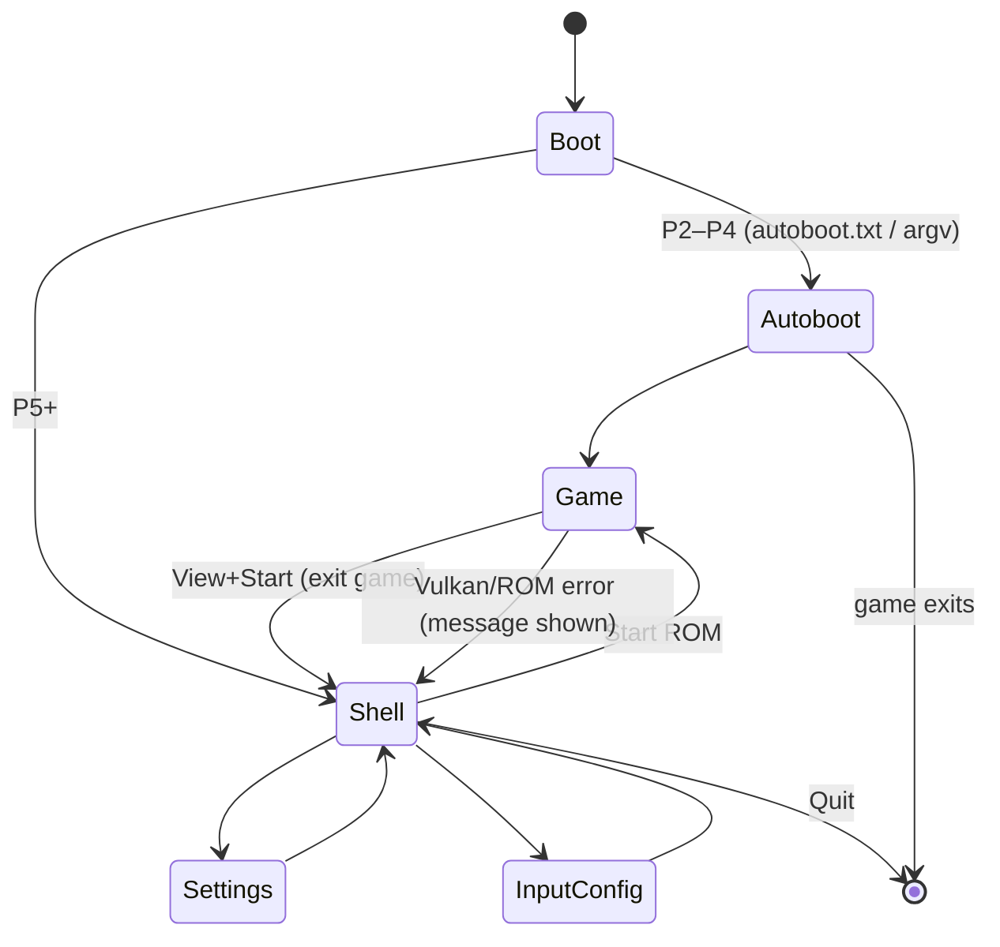

# 07 — Frontend / Launcher

How a user on a couch with a controller picks a ROM, changes settings and gets back to the menu.

## 1. Why not the existing GUI

| Existing desktop GUI (`src/ui/gui.rs`, `src/ui/gui/appwindow.slint`) | Problem on UWP |
|------------------------------------------------------------------------|----------------|
| slint `backend-winit` + `renderer-femtovg-wgpu` | winit has no CoreWindow backend; wgpu would need its own D3D12 UWP surface |
| Launches the game with `tokio::process::Command::new(current_exe)` (`gui.rs:582-640`) and the input configurator the same way (`:372-399`) | No process spawning in UWP |
| `rfd::AsyncFileDialog` (`gui.rs:741-788`) | COM dialogs unavailable |
| `open::that_detached` for links (`gui.rs:60-67`) | No shell |
| Update check via GitHub API (`gui.rs:29-58`) | Irrelevant for sideloaded builds |

The Android port faced the same problems and solved them with a native launcher activity that calls `gopher64_sdl_main` in-process — the same shape we use.

## 2. Phased approach

### 2.1 P2–P4: autoboot

- Host reads `{root}\autoboot.txt` (one line: absolute ROM path, optional extra CLI flags) and passes it as `argv` to `gopher64_uwp_main`.
- If missing, it boots the first `*.z64|*.n64|*.v64|*.zip|*.7z` in `{root}\roms\`.
- Zero UI code; perfect for bring-up.

### 2.2 P5: gamepad shell (ImGui, in the host)

| Aspect | Design |
|--------|--------|
| Toolkit | Dear ImGui (docking branch not needed) with `imgui_impl_sdl3` + `imgui_impl_sdlrenderer3` on SDL3-uwp's WinRT D3D11 renderer |
| Base code | Ymir's UWP shell (`Ymir/apps/ymir-sdl3/src/platform/uwp/shell/`, `docs/uwp/shell/{README,PLAN,ASSETS}.md`) |
| Navigation | `ImGuiConfigFlags_NavEnableGamepad`, keyboard nav off, `ImGuiConfigFlags_NoMouseCursorChange` (`SDL_SetCursor` throws on Xbox) |
| Fonts/scale | Scale for 10-foot UI (≈ 2× at 1080p); embed Roboto (gopher64 already embeds RobotoMono for the OSD) |
| ROM browser | Drive list (`GetLogicalDrives`) + `FindFirstFileExFromAppW`, filters `z64/n64/v64/zip/7z`, remembers last folder, recent list |
| Settings | Reads/writes gopher64's `config.json` via the Rust side (C ABI `gopher64_uwp_config_get/set(json)`), so the schema stays owned by `src/ui/config.rs` |
| Input page | Shows bound profile per port, "Configure" runs gopher64's existing profile flow (`--configure-input-profile`) in-process |
| Errors | Last error string from Rust (`gopher64_uwp_last_error()`) shown in a modal |
| Hand-over to game | Destroy ImGui context + `SDL_Renderer` (releases the D3D11 swapchain on the CoreWindow), then call `gopher64_uwp_main(argc, argv)`; on return re-create renderer + shell |

**Q-06:** can Dozen create a DXGI swapchain on the CoreWindow after SDL's D3D11 renderer released its own? Expected yes (one swapchain at a time per CoreWindow). Must be tested early in P5 — fallback: draw the shell with Vulkan through Granite (harder) or keep the shell in a separate frame via `SwapChainPanel` (XAML, more work).

### 2.3 Settings exposed in the shell (v1)

| Setting | `config.json` key (owner: `src/ui/config.rs`) | Notes |
|---------|-----------------------------------------------|-------|
| Upscaling 1×/2×/4× | `video.upscale` | 8× likely too heavy on Series S |
| CRT shader | `video.crt` | |
| Integer scaling / widescreen / crop | `video.*` | |
| Vsync | forced on | ([04 §3.5](04-vulkan-dozen.md#35-swapchain-details-on-uwp)) |
| Overclock VR4300 | `emulation.overclock` | |
| Disable Expansion Pak | `emulation.disable_expansion_pak` | |
| Controller per port / pak type | `input.*` | |
| Storage root | host setting (`force_localstate`) | |
| RetroAchievements login | `retroachievements.json` | P6 |

(Keys are indicative; the exact names are taken from `src/ui/config.rs` when implementing.)

## 3. In-game overlay (P5+, optional)

Pressing **View + B** (to be finalised) pauses emulation and shows a small menu (Resume / Save state / Load state / Slot / Reset / Exit). Two implementation options:

1. OSD text already rendered by `interface.cpp` (SDL_ttf → Vulkan image) extended with a selectable list — cheapest, stays inside the Vulkan frame.
2. ImGui rendered into a Vulkan image via `imgui_impl_vulkan` on Granite's device — richer but more code.

Option 1 first.

## 4. Future option: reuse the slint UI

slint supports custom platforms (`slint::platform::Platform`) with its software renderer drawing into a pixel buffer. A UWP platform could blit that buffer into an SDL texture and feed SDL gamepad events as key events. This would reuse `appwindow.slint` and its translations, but `gui.rs` needs a non-desktop action layer (no rfd, no process spawn). Worth revisiting after v1 if the ImGui shell feels too different from upstream's look.
