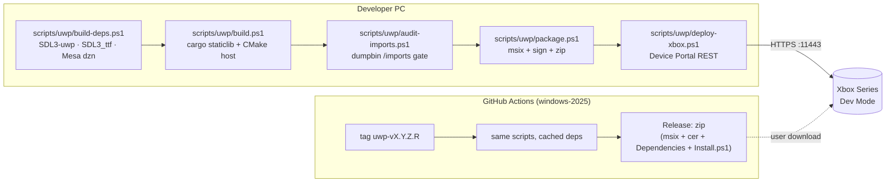

# 08 — Packaging & Deployment

## 1. Pipeline overview



## 2. Manifest (`uwp/Package.appxmanifest.in`)

Based on Ymir's `apps/ymir-sdl3/uwp/Package.appxmanifest.in`.

```xml
<Package
  xmlns="http://schemas.microsoft.com/appx/manifest/foundation/windows10"
  xmlns:uap="http://schemas.microsoft.com/appx/manifest/uap/windows10"
  xmlns:rescap="http://schemas.microsoft.com/appx/manifest/foundation/windows10/restrictedcapabilities"
  IgnorableNamespaces="uap rescap">

  <Identity Name="@G64_UWP_PACKAGE_NAME@" Publisher="@G64_UWP_PUBLISHER@" Version="@G64_UWP_VERSION@" />

  <Properties>
    <DisplayName>Gopher64</DisplayName>
    <PublisherDisplayName>Gopher64 UWP port</PublisherDisplayName>
    <Logo>Assets\StoreLogo.png</Logo>
  </Properties>

  <Dependencies>
    <TargetDeviceFamily Name="Windows.Universal" MinVersion="10.0.17763.0" MaxVersionTested="10.0.26100.0" />
  </Dependencies>

  <Resources><Resource Language="x-generate" /></Resources>

  <Applications>
    <Application Id="App" Executable="$targetnametoken$.exe" EntryPoint="Gopher64.App">
      <uap:VisualElements DisplayName="Gopher64" Description="Gopher64 - Nintendo 64 emulator"
          Square150x150Logo="Assets\Square150x150Logo.png" Square44x44Logo="Assets\Square44x44Logo.png"
          BackgroundColor="transparent">
        <uap:DefaultTile ShortName="Gopher64" Wide310x150Logo="Assets\Wide310x150Logo.png"
            Square310x310Logo="Assets\LargeTile.png" Square71x71Logo="Assets\SmallTile.png" />
        <uap:SplashScreen Image="Assets\SplashScreen.png" />
      </uap:VisualElements>
    </Application>
  </Applications>

  <Capabilities>
    <!-- No codeGeneration: gopher64 is a pure interpreter (no executable memory). -->
    <Capability Name="internetClient" />                         <!-- RetroAchievements (P6) -->
    <uap:Capability Name="removableStorage" />                   <!-- USB drives with ROMs/saves -->
    <rescap:Capability Name="runFullTrust" />                    <!-- plain Win32/std::fs on arbitrary paths -->
    <rescap:Capability Name="broadFileSystemAccess" />
    <rescap:Capability Name="expandedResources" />               <!-- Game mode resources -->
  </Capabilities>
</Package>
```

| Capability | Needed for | Required in |
|------------|-----------|-------------|
| `runFullTrust` + `broadFileSystemAccess` | `std::fs` / `*FromApp` on `E:\`, `F:\`…; without them only LocalState works | P2 |
| `removableStorage` | USB drives | P2 |
| `expandedResources` | Game-mode CPU/memory budget (≈5 GB reported on Series X vs ≈1 GB in App mode) | P2 |
| `internetClient` | RetroAchievements HTTPS | P6 (harmless earlier) |
| `privateNetworkClientServer` | only for a LAN TCP log sidecar in debug builds | debug |
| `codeGeneration` | **not needed** (no JIT) | — |

After install, set the app type to **Game** in Dev Home (per-app "View details" → App type). This is a manual console step; document it in the release README.

## 3. Assets

Full tile set or the packaging fails with `APPX1619`: `StoreLogo`, `Square44x44Logo` (+ `targetsize-*` variants), `Square150x150Logo`, `Wide310x150Logo`, `SmallTile` (71×71), `LargeTile` (310×310), `SplashScreen` (620×300). Generate from `data/icon/gopher64_512x512.png` with a script (Ymir `ShellAssets.cmake` / `ASSETS.md` describe its set).

## 4. Host CMake project (`uwp/CMakeLists.txt`)

```cmake
cmake_minimum_required(VERSION 3.24)
project(gopher64_uwp LANGUAGES CXX)
# configured with: -G "Visual Studio 18 2026" -A x64 -DCMAKE_SYSTEM_NAME=WindowsStore -DCMAKE_SYSTEM_VERSION=10.0

set(CMAKE_CXX_STANDARD 20)
find_package(SDL3 REQUIRED CONFIG)            # out/uwp-deps (SDL3-uwp)
find_package(SDL3_ttf REQUIRED CONFIG)

add_executable(gopher64_uwp WIN32
    src/main.cpp src/uwp_platform.cpp src/xaudio2_backend.cpp)
target_compile_definitions(gopher64_uwp PRIVATE GOPHER64_UWP _XBOX_UWP)
target_link_libraries(gopher64_uwp PRIVATE
    ${G64_RUST_LIB}                           # target/x86_64-uwp-windows-msvc/release/gopher64.lib
    SDL3::SDL3 SDL3_ttf::SDL3_ttf
    WindowsApp.lib xaudio2.lib
    ${G64_RUST_NATIVE_LIBS})                  # from --print native-static-libs (ntdll userenv ws2_32 dbghelp)
target_link_options(gopher64_uwp PRIVATE /STACK:8388608)

include(UWPPackaging.cmake)                   # manifest, assets, VS_DEPLOYMENT_CONTENT, signing
g64_uwp_package(gopher64_uwp
    DEPLOY_DLLS  $<TARGET_FILE:SDL3::SDL3> $<TARGET_FILE:SDL3_ttf::SDL3_ttf>
                 ${G64_DZN_DIR}/vulkan_dzn.dll ${G64_DZN_DIR}/dxil.dll)
```

Notes:
- The VS generator turns a `WindowsStore` executable into an appx project; `VS_DEPLOYMENT_CONTENT` + `VS_DEPLOYMENT_LOCATION` put DLLs/assets into the package (Ymir `UWPPackaging.cmake`).
- `xaudio2.lib` is the Windows 10+ XAudio 2.9 import lib in the SDK (part of the UWP partition).
- The host is C++20 **without** `/ZW`; C++/WinRT headers from the SDK (`<winrt/Windows.Storage.h>`) are used for `ApplicationData` and `ApplicationView`.

## 5. Signing

| Option | How | Publisher in manifest |
|--------|-----|-----------------------|
| Default (dev) | CMake's fallback key `Windows_TemporaryKey.pfx` | `CN=CMake Test Cert` |
| Release | `New-SelfSignedCertificate -Type CodeSigningCert -Subject "CN=Gopher64 UWP"` → `.pfx` (git-ignored) + exported `.cer` shipped in the zip (x-files-uwp `scripts/package.ps1`) | `CN=Gopher64 UWP` |

On the console: Device Portal → Certificates → install the `.cer` once (or rely on Dev Mode's sideload trust). On a PC: import the `.cer` into `LocalMachine\Root` and `LocalMachine\TrustedPeople` (error `0x800B0109` otherwise).

## 6. Deploy (Device Portal REST)

`scripts/uwp/deploy-xbox.ps1` (from Ymir), config in `scripts/uwp/xbox.env` (git-ignored; template `xbox.env.example`: `XBOX_IP`, `XBOX_USER`, `XBOX_PASS`).

```mermaid
sequenceDiagram
    participant S as deploy-xbox.ps1
    participant P as Device Portal (https://XBOX_IP:11443)
    S->>P: GET /api/os/info (basic auth) → CSRF-Token cookie
    S->>P: POST /api/app/packagemanager/package?package=<msix> (multipart: msix + VCLibs deps), X-CSRF-Token
    loop until done
        S->>P: GET /api/app/packagemanager/state
    end
    S->>P: GET /api/app/packagemanager/packages → find PackageFullName / PRAID
    S->>P: POST /api/taskmanager/app?appid=<appId>&package=<full name>  (-Launch; encoding as in Ymir deploy-xbox.ps1:116)
```

Additional scripts (from dosbox-pure-uwp / x-files-uwp / Ymir sets): `status.ps1`, `logs.ps1` (download `LocalState\gopher64.log` through the Device Portal app-data file API — exact endpoint and parameters as documented in x-files-uwp `docs/PORTAL-APPDATA.md`), `clean.ps1`, `loopback-exempt.ps1`.

## 7. Distribution zip

```text
gopher64-uwp-vX.Y.Z.R.zip
├─ gopher64_X.Y.Z.R_x64.msix
├─ gopher64.cer
├─ Dependencies\x64\Microsoft.VCLibs.x64.14.00.appx
├─ Install.ps1                (PC sideload helper)
└─ README.txt                 (install via Dev Home / Device Portal, set App type = Game, where to put ROMs)
```

## 8. Versioning

Four-part appx version from tag `uwp-vX.Y.Z.R`: `X.Y.Z` = upstream gopher64 version the build is based on (e.g. `1.1.42`), `R` = port revision (`uwp-v1.1.42.3`). Shown in the shell's About page together with `GIT_DESCRIBE` (`build.rs:284-301`) and the Mesa/SDL commit hashes.

## 9. CI (`.github/workflows/uwp.yml`, fork only)

| Step | Detail |
|------|--------|
| Runner | `windows-2025` (VS 2026 BuildTools + UWP workload; add via `vs_installer modify` if missing — `xbox-uwp-lab/scripts/provision-uwp.cmd` lists the component IDs) |
| Toolchain | `rustup toolchain install` from `rust-toolchain.toml` + `rustup component add rust-src`; LLVM matching rustc's major (as upstream `build.yml:112-131`) |
| Cache | `out/uwp-deps` keyed by SDL3-uwp / SDL3_ttf / mesa commit hashes; cargo registry + target |
| Build | `build-deps.ps1` (cache miss only) → `build.ps1 -Configuration Release` → `audit-imports.ps1` → `package.ps1` |
| Artifacts | zip on every push to `uwp/main`; GitHub Release on `uwp-v*` tags |
| Secrets | `UWP_PFX_BASE64`, `UWP_PFX_PASSWORD` (optional; falls back to CMake test cert) |
