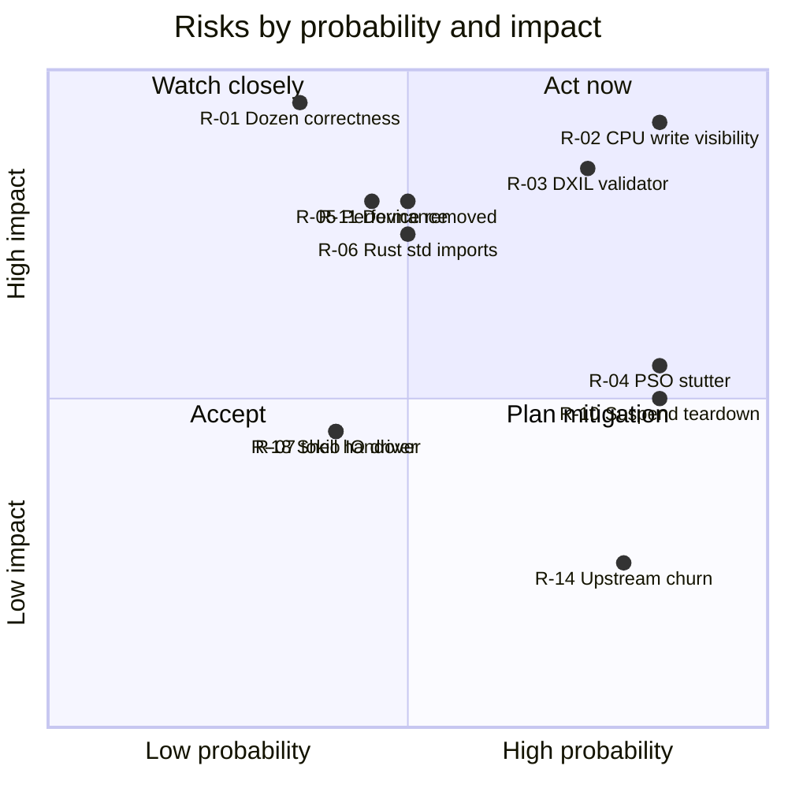

# 09 — Risk Register

Scoring: **Probability** (L/M/H) × **Impact** (Low/Med/High/Critical). "Gate" = the phase whose exit criteria retire the risk. Review this table at the end of every phase.

## 1. Overview

## 2. Register

| ID | Risk | P | I | Gate | Mitigation | Kill / escalation criterion |
|----|------|---|---|------|-----------|-----------------------------|
| **R-01** | parallel-rdp renders incorrectly or fails init on Dozen | L–M | Critical | P0 | P0 on PC with Dozen as only driver; triage knobs (`PARALLEL_RDP_SUBGROUP=0`, `UBERSHADER=1`, 8-bit on/off, `ALLOW_EXTERNAL_HOST=0`); Mesa fixes in our fork. Probability lowered after five shipped Dozen-on-Xbox projects ([11](11-prior-art.md)) | Unfixable corruption in ≥ 2 of the 4 reference games after 2 weeks of triage → re-plan renderer (native D3D12 port of parallel-rdp shaders via SPIRV-Cross/DXC, months) |
| **R-02** | CPU writes through WRITE_BACK host-visible mappings not visible to the Xbox GPU (black/stale frames) | H | Critical | P3 | Port OnyxEMU `0014` (M-01); console smoke test that uploads a pattern via mapped memory and reads it back on GPU; savestate staging path ([04 §3.6](04-vulkan-dozen.md#36-mesa-patch-plan-for-our-mesa-uwp-fork)) | — (known fix exists) |
| **R-03** | Series S DXIL validator rejects Dozen shaders → pipelines fail | H | High | P3 | M-02 (self-signing / validator target 1.7); log every refused pipeline with stage dump (M-06); test Series S early | If refused shaders persist even with self-signing → investigate per-shader NIR lowering |
| **R-04** | Pipeline compile stutter (0.4–0.7 s per PSO on Xbox) | H | Med | P4 | Async compiles (default), M-05 D3D12 pipeline library, Mesa disk cache, first-boot warm-up, ubershader fallback | Stutter > 5 s cumulative in the first minute of SM64 after warm cache → ubershader by default |
| **R-05** | Not full speed (interpreter on Zen 2 + Dozen overhead + incoherent RDRAM copies) | M | High | P4 | Measure split (CPU emu ms / RDP GPU ms / present wait); `target-cpu=x86-64-v3`; 1× upscale default; profile with `PARALLEL_RDP_BENCH`; reduce RDRAM resolve traffic | < 90 % speed in SM64 at 1× → profiling sprint before P5 |
| **R-06** | Rust std (Tier-3 UWP) imports functions/DLLs absent on the console (`ntdll`, `userenv`, `dbghelp` or desktop-only APIs) → app fails to load | M | High | P1/P2 | Import audit gate (`audit-imports.ps1`); `panic=abort`; avoid `remove_dir_all`, `home_dir`; patch call sites or provide shims | Unresolvable loader failure → build std with patched `library/` (we already build std from source) |
| **R-07** | tokio IO driver (mio/AFD via `NtDeviceIoControlFile`) fails in AppContainer | M | Med | P2 | Build runtime without `enable_io` on UWP if reqwest is not needed; RA gated off until verified | RA postponed |
| **R-08** | Version skew: `sdl3-sys 0.7.2` (SDL 3.4.18 bindings) vs SDL3-uwp 3.4.16 → missing symbols | M | Low–Med | P1 | Link-time detection; rebase SDL3-uwp to 3.4.18 or pin `sdl3-sys` to a 3.4.16-era release on UWP | — |
| **R-09** | UI-thread execution: 8 MiB stack not honoured, watchdog, unresponsive CoreWindow during long loads | M | Med | P2 | `/STACK:8388608`; early activation; loading screen; fallback worker thread + M-10 | Stack overflow or watchdog kill not fixable → worker-thread model |
| **R-10** | Suspend handler (`SDL_EVENT_WILL_ENTER_BACKGROUND` → `deinit_surface_and_swapchain`, `interface.cpp:316-317`) leaves a black screen after resume (no `RENDER_DEVICE_RESET` on UWP) | H | Med | P4 | Guard with `#ifndef GOPHER64_UWP`; on UWP pause + flush saves instead | — |
| **R-11** | `DXGI_ERROR_DEVICE_REMOVED` / "Out of host memory" on Series S (smaller memory, stricter driver) | M | High | P3/P4 | M-03, M-04; log GPU memory budget; cap upscale on Series S; test Series S every phase from P3 | — |
| **R-12** | Memory budget: App mode ≈ 1 GB | L | High | P2 | `expandedResources` + App type = Game; measure and log available memory at boot | — |
| **R-13** | Audio crackle/drift with XAudio2 | M | Med | P4 | 4 × 12 ms ring, reuse gopher64's ratio control via `SetFrequencyRatio`, underrun counters in log | — |
| **R-14** | Upstream churn → merge conflicts (`Cargo.toml` tables, `interface.cpp`, `video.rs`, `audio.rs`) | H | Low | continuous | Small `cfg`-isolated hunks; weekly syncs; conflict playbook ([12](12-upstream-sync.md)); upstream generic improvements (feature flags for netplay/discord) | — |
| **R-15** | Mesa patch series maintenance on rebases | M | Med | P3+ | Numbered patch series, pinned Mesa base, rebase only per release; upstream generic patches | — |
| **R-16** | Licensing: borrowing from projects with incompatible/no license (`Cosmo/mesa_ai_slop_version` has none) | L | Med | continuous | Only copy from GPL-3.0-compatible sources (OnyxEMU GPL-3.0, Mesa MIT); reimplement ideas otherwise; record provenance in patch headers | — |
| **R-17** | C/asm deps (ring, zstd-sys, rcheevos, volk, parallel-rdp) fail to build/link for the UWP target with clang-cl | L–M | Med | P1 | `/FI` compat header; target-specific CC vars; drop RA/ring if blocked | — |
| **R-18** | Shell (SDL D3D11 renderer) → game (Dozen DXGI swapchain) hand-over on the same CoreWindow fails (Q-06) | M | Med | P5 | Destroy renderer first; test early in P5; fallback: Vulkan-rendered shell or SwapChainPanel | — |
| **R-19** | `RUSTC_BOOTSTRAP` + `-Zbuild-std` break on an upstream toolchain bump | L | Med | continuous | Fallback to a pinned nightly; CI catches it on sync | — |
| **R-20** | Granite/volk desktop-only APIs (`LoadLibraryA`, `MessageBoxA`) under `WINAPI_FAMILY_APP` | M | Low | P1 | Compat header via `/FI` ([05 §7.1](05-rust-uwp-toolchain.md#71-cc-sources-under-winapi_family_app--the-compat-header)) | — |
| **R-21** | Env vars set from Rust not visible to C `getenv` (Q-07) → parallel-rdp/Mesa knobs ignored | M | Low | P2 | Set from host with `_putenv_s` before init | — |
| **R-22** | Storage: external drive probe picks a drive that later disappears (USB unplug) | L | Med | P4 | Re-probe on launch; saves written atomically (temp + rename); warn in shell | — |

## 3. Kill criteria summary

The project is re-planned (not abandoned) if:

1. **P0 fails** (R-01): Dozen cannot run parallel-rdp correctly on a PC and the failure is not attributable to a fixable Mesa bug → evaluate (a) native D3D12 back-end for parallel-rdp, (b) different N64 renderer for the Xbox build.
2. **P3 fails after M-01/M-02/M-03** (R-02/R-03/R-11): no stable frame on Series X after the known Xbox fixes → switch presentation to option B and re-test; if still failing, treat as (1).
3. **P4 speed < 90 %** in SM64 at 1× after profiling (R-05) → document as "experimental", investigate interpreter hot spots (still valuable for upstream).
