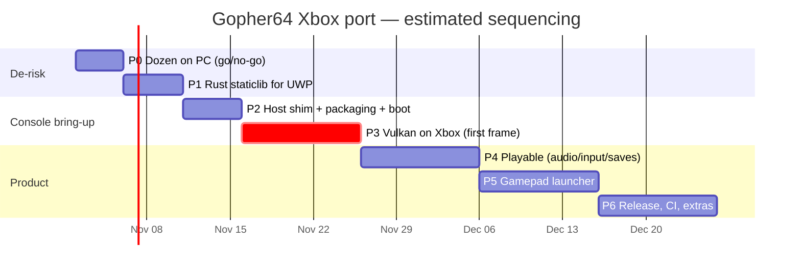
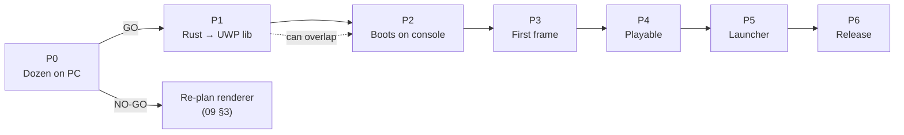

# 10 — Roadmap & Checklist

Phases are ordered to **retire the biggest risks first**. Each phase has tasks (checkboxes), deliverables and exit criteria. Tick boxes in this file as work lands (with the commit hash where useful).

## 1. Timeline (estimate)

Effort estimates assume part-time work; they are for sequencing, not commitments.

---

## P0 — Validate parallel-rdp on Dozen (Windows PC)

**Goal:** prove the renderer logic works on Dozen before investing in UWP. No code changes in gopher64.

**2026-10-30 checkpoint (`uwp-v0.0.2`):** all four games matched native in short
user-observed tests on Dozen 26.2.4 / NVIDIA with `UBERSHADER=1`, required 8-bit
storage, external host import disabled and single-threaded commands. SM64 passed
1×/2×/4× at 30 FPS / 60 VI/s; savestate round trips passed in MK64/OoT/GoldenEye.
All 237 RDP suites passed a reduced run. Recommendation: scoped GO to P1;
coherent mode and exact renderer subgroup diagnostics remain open. See
[handoff and next steps](14-p0-handoff.md) and [results](13-testing-debugging.md#p0-results).

- [x] Create branch `uwp/main` from `main` (D-16); commit `docs/xbox-port/` (`1d0394a`)
- [x] `git submodule update --init --recursive` (all pinned submodules initialised)
- [x] Build desktop gopher64 as upstream does (`cargo build --release`) and run SM64 on the native driver (user courtyard screenshot: 30 FPS / 60 VI/s)
- [x] Install the Vulkan SDK (for `vulkaninfo`) or use `vulkaninfo` from the GPU driver package
- [x] Obtain desktop Dozen: build `mesa-uwp` **without** `--uwp` (desktop target) with meson-uwp, or use a prebuilt desktop release; keep `vulkan_dzn.dll` + `dzn_icd.x86_64.json`
- [x] `VK_DRIVER_FILES=…\dzn_icd.x86_64.json vulkaninfo --summary` shows only `Microsoft Direct3D12 (…)`, `driverID = MESA_DOZEN`
- [x] Run gopher64 on Dozen: SM64, MK64, Zelda OoT, GoldenEye; compare with baseline (short manual gameplay, requested 2 min; duration not timed)
- [x] Repeat with `PARALLEL_RDP_ALLOW_EXTERNAL_HOST=0` (all four working runs used this Xbox-like incoherent RDRAM path)
- [x] Enable `dzn_enable_8bit_loads_stores=true` (required); repeat with `PARALLEL_RDP_SUBGROUP=0` (SM64 triage remained corrupted; accepted working configuration uses ubershader)
- [x] Test save state → load state round trip on Dozen (MK64: user confirmed new F5 → F7 restores correctly; visual check, not bit-exact frame comparison)
- [x] Test upscale 2× and 4× (SM64 / NVIDIA / Dozen 26.2.4 ubershader: correct image, 30 FPS / 60 VI/s at both scales)
- [x] Capture driver feature dump and available renderer logs ([13 §4](13-testing-debugging.md#p0-results))
- [ ] Capture exact selected renderer subgroup caps (not exposed by current logs)
- [x] Record results in [13 §4](13-testing-debugging.md#p0-results)

**Exit criteria:** all four games render identically (visually) to the native driver in coherent and incoherent modes, ≥ 100 % speed on the PC. → **GO**. Otherwise follow [04 §7](04-vulkan-dozen.md#7-p0--validating-dozen-on-a-windows-pc-before-any-xbox-work) triage and [09 §3](09-risks.md#3-kill-criteria-summary).

**Scope exception proposed for P1:** coherent Dozen import failed despite advertised
support. The tested path is the incoherent fallback expected on Xbox, with
ubershader required. Results justify toolchain bring-up, but do not claim the
original two-mode criterion passed. Intel and Xbox validation remain separate.

---

## P1 — gopher64 as a UWP staticlib

**Goal:** `gopher64.lib` for `x86_64-uwp-windows-msvc` with a clean import audit.

- [ ] `rustup component add rust-src` for the pinned toolchain (✔ done for 1.99.1 on this PC)
- [ ] Install LLVM/clang-cl matching rustc's LLVM major; verify `clang-cl --version`
- [ ] `scripts/uwp/build-deps.ps1`: SDL3-uwp (DLL) → `out/uwp-deps`; SDL3_ttf 3.2.x (DLL) against it
- [ ] Generate `.cargo/uwp-links.toml` with `links` overrides for `SDL3` and `SDL3_ttf` (D-05)
- [ ] `Cargo.toml`: target-specific dependency tables ([05 §5](05-rust-uwp-toolchain.md#5-planned-cargotoml-changes))
- [ ] `.cargo/config.toml`: `[target.x86_64-uwp-windows-msvc]` + `CC/CXX/AR_x86_64_uwp_windows_msvc`
- [ ] `build.rs`: `uwp` block (defines, no `-flto=thin`, no winresource, `/FI` compat header) ([05 §7](05-rust-uwp-toolchain.md#7-planned-buildrs-changes))
- [ ] `uwp/compat/g64_uwp_compat.h` (`LoadLibraryA` decl, `MessageBoxA` → stderr)
- [ ] `src/lib.rs`: `uwp` module with `gopher64_uwp_main`, `gopher64_uwp_set_root`, panic hook
- [ ] `src/ui.rs`: `get_dirs()` UWP branch; `WEB_CLIENT` webpki-roots branch; WGI + back-button hints
- [ ] `src/ui/uwp/time.rs` (`precise_sleep`) and cfg-gated hook at `src/device/vi.rs:223`
- [ ] Netplay / Discord / USB stubs on UWP
- [ ] `src/ui/audio.rs`: UWP branch calling `g64_audio_*` (stubs OK for P1)
- [ ] `src/ui/video.rs`: UWP window flags
- [ ] `parallel-rdp/interface.cpp`: `g64_load_dozen()` + guard Android suspend teardown; `wsi_platform.cpp`: UWP surface
- [ ] Build: `cargo rustc --lib --release --crate-type staticlib --target x86_64-uwp-windows-msvc --no-default-features -Zbuild-std=std,panic_abort`
- [ ] Desktop build still compiles and runs unchanged (`cargo build --release`, `cargo clippy --no-default-features`)
- [ ] Record `--print native-static-libs`

**Exit criteria:** staticlib builds from a clean checkout via `scripts/uwp/build.ps1`; desktop build unaffected; diff is `cfg`-isolated.

---

## P2 — Host shim, packaging, boot on console

**Goal:** the msix installs and launches from the tile; the log shows gopher64 initialising.

- [ ] Read Ymir `docs/uwp/HANDOFF.md` (T-01…T-18) and scummvm-uwp `docs/XBOX-TILE-LAUNCH-KILL.md`
- [ ] `uwp/CMakeLists.txt`, `UWPPackaging.cmake`, `Package.appxmanifest.in`, `Assets/` (from Ymir)
- [ ] `uwp/src/main.cpp`: `SDL_main` → hints → root probe → `gopher64_uwp_set_root` → `gopher64_uwp_main(autoboot args)`
- [ ] `uwp/src/uwp_platform.cpp`: fd-level stdout/stderr redirect, VEH for `DBG_PRINTEXCEPTION_*`, unhandled-exception logger, `UseFullCoreWindowBounds`, drive probe
- [ ] `/STACK:8388608`; link `WindowsApp.lib`, store CRT, Rust native libs
- [ ] `scripts/uwp/audit-imports.ps1`: fail on `user32`, `gdi32`, `shell32`, `winmm`, `dwmapi`, `uxtheme`; print remaining imports
- [ ] `scripts/uwp/{build,package,deploy-xbox}.ps1`, `xbox.env.example`
- [ ] Sideload on a Windows PC first (same msix) — PC UWP runtime catches many issues quickly
- [ ] Deploy to Series X; set App type = **Game**; launch from tile (not debugger)
- [ ] Log: root path chosen, memory available, tokio runtime up, ROM loaded, `video::init` reached
- [ ] Answer Q-01 (stack), Q-04 (memory), Q-10 (tokio IO), Q-11 (`LoadLibraryA` import), Q-07 (env visibility)

**Exit criteria:** tile launch survives the watchdog 10/10 times; log reaches `rdp_init` (Vulkan may still fail).

---

## P3 — Vulkan on Xbox: first frame

**Goal:** SM64 title screen on the TV via Dozen.

- [ ] Fork mesa-uwp → branch `gopher64/dzn-xbox`; build UWP Dozen with meson-uwp (`-Dvulkan-drivers=microsoft-experimental -Dgallium-drivers= -Dc_args="/D _XBOX_UWP" -Dcpp_args="/D _XBOX_UWP"`)
- [ ] (Shortcut for first light) try RetroArch's prebuilt mesa-uwp `vulkan_dzn.dll` + `dxil.dll`
- [ ] Port M-06 (log hook) first — every later step depends on Mesa logs in our log file
- [ ] Port M-01 (write-combined memory) and M-02 (DXIL validation/self-sign)
- [ ] Enable required 8-bit storage (M-09) and verify 8/16-bit storage on both consoles
- [ ] Package `vulkan_dzn.dll`, `dxil.dll`
- [ ] Console smoke tests (before running a game):
  - [ ] Feature dump logged (Q-02 16-bit/WaveOps, Q-03 `ID3D12Device13`, Q-09 device type)
  - [ ] CPU-write visibility: fill a host-visible buffer from the CPU, copy on GPU, read back → must match (R-02)
  - [ ] Compile all parallel-rdp pipelines once; count refused pipelines (R-03)
  - [ ] Swapchain on CoreWindow: clear-colour frames for 10 s (validates D-18 option A, Q-08 extent)
- [ ] Boot SM64 → title screen; then 2 min gameplay
- [ ] Series S run of the same
- [ ] Port M-03, M-04 as needed by observed failures

**Exit criteria:** SM64 renders correctly on Series X and Series S for 10 min without device removal.

---

## P4 — Playable

- [ ] XAudio2 backend (`uwp/src/xaudio2_backend.cpp`) wired to `audio.rs`; drift control via `SetFrequencyRatio`
- [ ] Default Xbox controller profile auto-bound to port 1; rumble works
- [ ] Gamepad hotkeys verified (save/load state, exit, fast-forward, rewind); add gamepad combos for reset, FPS, slot select
- [ ] Lifecycle: suspend/resume without black screen (R-10); saves flushed on suspend
- [ ] Save files land in `{root}\data\saves`, survive reinstall (external root)
- [ ] Save-state round trip identical (TMEM/hidden RDRAM path, M-01)
- [ ] Speed: SM64, MK64, OoT, GoldenEye ≥ 100 % at 1× on Series X; measure Series S
- [ ] Shader cache persisted (M-05); measure first-boot vs second-boot stutter
- [ ] Upscale 2× (and 4× on Series X) performance

**Exit criteria:** the four reference games are playable start-to-first-level with sound, saves and states, at full speed on Series X.

---

## P5 — Gamepad launcher

- [ ] ImGui + `imgui_impl_sdl3` + `imgui_impl_sdlrenderer3` in the host
- [ ] Port Ymir shell skeleton (navigation, theme, 10-foot scaling)
- [ ] ROM browser (drives, folders, filters, recent)
- [ ] Settings page backed by gopher64 `config.json` via C ABI
- [ ] Input page (profile per port, configure)
- [ ] Shell → game → shell hand-over (Q-06, R-18)
- [ ] Error modal for Vulkan / ROM failures
- [ ] About page (versions, commit hashes)

**Exit criteria:** a fresh install can be used end-to-end with only a controller.

---

## P6 — Release & extras

- [ ] `.github/workflows/uwp.yml` with dependency cache and tag releases
- [ ] Signed release zip (msix + cer + VCLibs + Install.ps1 + README)
- [ ] Compatibility table (top 30 games) in the release README
- [ ] RetroAchievements (rustls + webpki-roots; `internetClient`) — if Q-05/Q-10 are green
- [ ] In-game overlay menu (OSD-based)
- [ ] Consider presenting option B (external images → D3D12) for HDR / pacing
- [ ] Upstream contributions: `netplay`/`discord` Cargo features, generic Mesa fixes, SDL3-uwp WASAPI fix
- [ ] Submit to the EmulationRevival hub

---

## Open questions

| ID | Question | Answered in | Answer |
|----|----------|-------------|--------|
| Q-01 | Does the UI thread honour the exe's `/STACK:8388608` under CoreApplication? | P2 | |
| Q-02 | Does Xbox D3D12 report `Native16BitShaderOpsSupported` and `WaveOps` (→ int16 + subgroups in Dozen)? | P3 | |
| Q-03 | Does the Xbox D3D12 runtime expose `ID3D12Device13` (→ `VK_EXT_external_memory_host`)? | P3 | expected no |
| Q-04 | Real memory available in Game mode on Series X and Series S? | P2 | |
| Q-05 | Does `ring 0.17` build and run for `x86_64-uwp-windows-msvc`? | P1/P6 | |
| Q-06 | Can Dozen create a CoreWindow swapchain after SDL's D3D11 renderer released its own? | P5 | |
| Q-07 | Are `std::env::set_var` values visible to C `getenv` in parallel-rdp/Mesa on UWP? | P2 | |
| Q-08 | Do SDL3-uwp's window size and Mesa's `uwp_get_width/height` agree on a 4K TV? | P3 | |
| Q-09 | Which `VkPhysicalDeviceType` does Dozen report on Xbox (integrated/UMA?) | P3 | |
| Q-10 | Does tokio's IO driver (mio/AFD) initialise inside the AppContainer? | P2 | |
| Q-11 | Does a `LoadLibraryA` import (never called) resolve at load time on the console? | P2 | |
| Q-12 | Is `SDL_HideCursor` harmless on Xbox (unlike `SDL_SetCursor`)? | P2 | |
| Q-13 | Exact suspend/resume behaviour in Dev Mode Game mode (guide button, dashboard, other app)? | P4 | |
