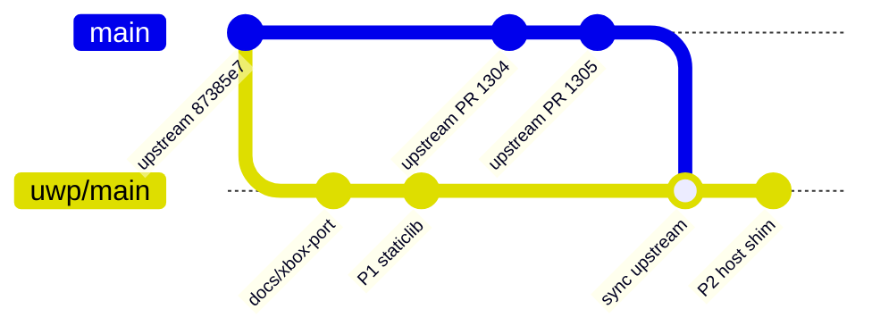

# 12 — Upstream Sync & Branching

## 1. Remotes and branches

| Remote | URL | Role |
|--------|-----|------|
| `origin` | `git@github-personal:marcelofrau/gopher64` | Our fork |
| `upstream` | `https://github.com/gopher64/gopher64.git` | Original project (added 2026-10-28) |

| Branch | Content | Rule |
|--------|---------|------|
| `main` | Exact mirror of `upstream/main` | **Fast-forward only.** Never commit port work here. |
| `uwp/main` | `main` + Xbox port | All port work lands here (merge commits from `main` for syncs) |
| `uwp/<topic>` | Short-lived feature branches (`uwp/p1-staticlib`, `uwp/p3-dozen`, …) | Merge into `uwp/main` |

Dependent repositories we fork/pin:

| Repo | Branch we use | Pin recorded in |
|------|---------------|-----------------|
| SDL3-uwp (SternXD) | `uwp-3.4.16` (or our rebase) | `scripts/uwp/deps.lock.json` |
| SDL_ttf | `release-3.2.x` tag | same |
| mesa-uwp (our fork of SternXD) | `gopher64/dzn-xbox` | same |
| meson-uwp (SternXD) | `master` @ `8961a3e3f` | same |

## 2. Sync procedure



```bash
git fetch upstream
git checkout main
git merge --ff-only upstream/main          # must succeed; if not, someone committed to main by mistake
git push origin main

git checkout uwp/main
git merge main                             # resolve conflicts with the playbook below
scripts/uwp/build.ps1 -Configuration Release   # UWP build still green
cargo build --release                      # desktop build still green
git push origin uwp/main
```

Cadence: weekly, plus immediately after upstream changes to `parallel-rdp/`, `src/ui/video.rs`, `src/ui/audio.rs`, `build.rs`, `Cargo.toml`, `rust-toolchain.toml`.

## 3. Where conflicts will happen (and how to keep them small)

| File | Our change | Conflict strategy |
|------|-----------|-------------------|
| `Cargo.toml` | Split dependency tables by target | Keep upstream ordering inside each table; when upstream bumps a version, apply it in **all** tables containing that crate |
| `Cargo.lock` | New deps (`webpki-roots` on UWP) | Take upstream's, then `cargo update -p <ours>`; never hand-merge |
| `build.rs` | `uwp` block | Keep it as one contiguous block guarded by `if uwp` |
| `.cargo/config.toml` | UWP target section | Separate section at the end of the file |
| `parallel-rdp/interface.cpp`, `wsi_platform.cpp` | `#ifdef GOPHER64_UWP` blocks | Small, self-contained `#ifdef` blocks; never interleave with upstream lines |
| `src/ui/audio.rs`, `video.rs`, `ui.rs` | `cfg` branches | Prefer delegating to `src/ui/uwp/*.rs` modules so the touched upstream lines are one-liners |
| `src/device/vi.rs:223` | `precise_sleep` | One line |
| `rust-toolchain.toml` | none | Accept upstream; CI adds `rust-src` for the new version |
| `parallel-rdp/parallel-rdp-standalone` (submodule) | none | Accept upstream pointer; re-run P0 checks on Dozen when it moves (renderer changes may hit Dozen differently) |

Rule of thumb: **new files over edits**. Platform code goes to `src/ui/uwp/`, `uwp/`, `scripts/uwp/`, `docs/xbox-port/` — files upstream never touches. The binding rules are in [00 — Upstream fidelity rules](00-upstream-fidelity-rules.md).

## 4. Upstreaming candidates

Small, generic changes that would reduce our diff if upstream accepted them:

1. Cargo features `netplay` and `discord` (default on) instead of always-compiled deps.
2. A `precise_sleep` abstraction instead of calling `spin_sleep` directly (also useful for future platforms).
3. Optional loader override hook in `interface.cpp` (generalises the Android adrenotools path).
4. `get_dirs()` override via an env var / API for embedders.

Propose them only after the port works, with the Xbox port as the motivating use case.

## 5. Release tagging

- Tag `uwp-v<upstream-version>.<port-rev>` on `uwp/main` (e.g. `uwp-v1.1.42.1`).
- After a sync that changes the upstream version, reset `<port-rev>` to `1`.
