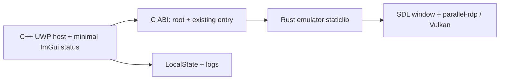

# P2 — host and frontend integration plan

**Status:** original design and source review. The host now builds and the status screen runs on PC; see [17](17-p2-implementation-handoff.md) and [the work journal](memory-handoff.md) for current evidence and pending console validation.

## Direction and scope

Build a separate C++ SDL3/ImGui UWP frontend in the same process as the Rust static library. Preserve the existing Slint desktop frontend, its configuration, and existing desktop behavior. In P2, provide only a small status/error screen and an explicit test-ROM autoboot path. The full game library, settings screens, controller navigation, and proven game-to-menu flow remain later work. The P3 renderer and P4 playable features are not prerequisites for a functioning P2 host screen.

This is one executable, not an IPC design. Initial calls use the existing ABI; extend it only when a concrete frontend interaction requires it. Later configuration editing must use Rust as the source of truth rather than a second C++ configuration implementation.

## Evidence and integration decisions

| Topic | What the source actually does | P2 decision / unresolved work |
|---|---|---|
| Entry and runtime | `src/ui/uwp/entry.rs:43-71` parses argv, starts a Tokio runtime, and synchronously calls `run` on the calling thread; it signals the runtime thread on return. `src/lib.rs:129-145` reads the ROM and returns an error when it cannot. | Call it on the SDL/WinRT main thread for the initial autoboot. The C++ status loop cannot keep rendering while this blocking call runs. Record the return code and logs; do not promise a responsive overlay during a game. Verify runtime-thread shutdown before assuming repeated calls are safe. |
| Window | `src/ui/video.rs:41-143` initializes SDL video and creates the game window; `src/ui/video.rs` closes it at the end of the session. | The host owns the status UI while it is active, then relinquishes its window/renderer before the current Rust path creates a game window. **Whether sequential windows work with UWP CoreWindow is unproven**. Test this explicitly; reuse of one window requires a UWP-specific hook and separate ownership/teardown proof, not an assumption. Do not mix concurrent presents on one CoreWindow. |
| SDL lifetime | `src/ui.rs:181-209` initializes subsystems but `sdl_close()` calls global `TTF_Quit()` and `SDL_Quit()`; `src/lib.rs:358` invokes it. Early error paths do not all follow the same cleanup. | Do not keep host-owned SDL/TTF objects alive across this call as-is. Prove an orderly shutdown/reinitialization sequence or add a narrowly scoped UWP ownership boundary. Balance subsystem and TTF lifecycle and verify errors and repeated sessions; leave desktop behavior unchanged. |
| Events and thread | `parallel-rdp/interface.cpp:157-161,394-403,516` installs an event watch; `parallel-rdp/wsi_platform.cpp:53` pumps SDL events. SDL's [`SDL_PumpEvents`](https://wiki.libsdl.org/SDL3/SDL_PumpEvents) and [`SDL_CreateWindow`](https://wiki.libsdl.org/SDL3/SDL_CreateWindow) require the main thread. | Do not blindly move `gopher64_uwp_main` to a worker just to keep ImGui responsive: the game currently creates a window and pumps events itself. Keep exactly one event owner per phase, and investigate long blocking init/Present and CoreWindow activation before choosing a long-term split. |
| Session end | `src/device.rs:119-131` runs the CPU synchronously, then closes input, audio and video; `parallel-rdp/interface.cpp:157-161` stops the core on window-close or termination events. This is not yet a frontend-controlled stop API. | Do not synthesize OS termination to mean “return to menu”. A proper session stop and return path, including resource cleanup and repeated sessions, must be designed and tested when needed; P2 autoboot does not claim it exists. |
| Errors | `src/ui/uwp/entry.rs:55-68` returns 1 for argument/`run` errors; `src/ui.rs:181-201`, `src/ui/audio.rs:60-78`, and `src/ui/video.rs` can panic. UWP builds use `panic=abort`. | Test a missing ROM for a recoverable error. A panic aborts the process and cannot simply be caught at the C ABI. Log explicitly before initialization and failures; make only required initialization failures recoverable with structured cleanup when implementing them. Don't claim all failures return to UI. |
| Storage | `src/ui/uwp/mod.rs:8-34` accepts a host-provided root but falls back to the executable directory. `src/ui/config.rs:124-145` writes the existing Rust config on drop, but silently ignores `File::create` failures. | For initial P2 tests the host obtains a writable UWP LocalState path, converts it to UTF-8, and sets root before Rust calls; this does not settle the longer-term external-drive-first policy in D-10. Verify root/config/saves/states and make write errors visible; do not rely on the package install directory being writable. Test failure paths in temporary directories without touching existing user data. Copy a user-supplied test ROM to an accessible location for autoboot; do not bundle a commercial ROM. |
| Graphics | `src/ui/video.rs:70` requests `SDL_WINDOW_VULKAN`; `parallel-rdp/wsi_platform.cpp:4-13` calls `SDL_Vulkan_CreateSurface`. The planned UWP Dozen/CoreWindow path is not yet implemented. | P2 proves host and the Rust entry independently of P3. Attempt to reach video init with clear stage markers; if UWP Vulkan setup blocks it, record the precise result and P3 dependency rather than claiming `rdp_init` or a first frame. |

**Ymir comparison:** `../Ymir/apps/ymir-sdl3/src/app/app.cpp:71-76,1815-1816,3988-4001` uses a dedicated emulator thread while the UI thread owns SDL event polling and feeds ImGui. Its UWP boot uses a D3D12/ImGui frontend (`../Ymir/docs/uwp/HANDOFF.md`, boot summary), not proof that Gopher64's blocking core and Vulkan WSI can simply run on a worker. Reuse its separation of responsibilities and its observed boot diagnostics, not the thread topology or renderer blindly. Renderer backend for the minimal ImGui screen remains an implementation choice after checking the actual UWP/CoreWindow support and the handoff above.

**Audio correction:** [D-08](03-decisions.md#d-08) and `../Ymir/docs/uwp/HANDOFF.md` runs 05–08 document Xbox SDL WASAPI blocking at `SDL_OpenAudioDeviceStream`; worker plus ~5,000 event-pump iterations also timed out. The same handoff records XAudio2 initialization and playback starting on console. Gopher64 calls that SDL API (`src/ui/audio.rs:60-78`), but its own Xbox behavior is **not yet measured**. Compilation is not a runtime test. Keep XAudio2 as the evidence-backed P4 direction, adapted and validated for this project; do not build it speculatively as a prerequisite for the P2 status screen. If a P2 ROM attempt gets past video initialization, instrument audio entry/exit and expect a possible block, not a recoverable error.

## Implementation sequence and checks

1. **Link and imports.** Create the smallest UWP C++ host and VS 2026/CMake project that actually links the staticlib; resolve `--print native-static-libs`, Store CRT, UWP-safe APIs, SDL DLLs and package dependencies. Audit final executable **and shipped DLLs**; identify imports by DLL/API and explain exceptions instead of assuming every system DLL name is always forbidden. A static archive alone is not an import audit. Build Debug and Release without altering desktop.
2. **Visible startup and packaging.** Add a real manifest, assets, local logging and a minimal C++/ImGui status screen. Activate the window before expensive work. Use Ymir and `../scummvm-uwp/docs/XBOX-TILE-LAUNCH-KILL.md` as evidence for early activation and for independently testing F5 versus tile; do not copy exception handlers or watchdog workarounds without matching evidence. Surface package, dependency, certificate, SDL initialization and logging failures rather than silently continuing. Generate a solution with the real executable as startup target.
3. **Automate the PC workflow.** Extend scripts for host build, packaging and PC installation; document prerequisites, Debug/Release, actual package artifacts and VS 2026 Xbox remote settings. The user alone deploys to and launches on Xbox; agents must not connect to it. No secrets, console address, certificate password or commercial ROM in version control. Preserve the existing staticlib commands and avoid destructive default cleanup.
4. **Windows UWP smoke tests.** Install/run the package on PC; confirm status screen, persisted timestamped startup log, LocalState writes, clean exit, and a missing-ROM error reaching the host. For autoboot, transfer a user-supplied test ROM to an accessible location, log chosen path and stage outcomes, and distinguish ROM load, video initialization and renderer failures. Exercise cleanup/reinitialization where implemented; record any failed phase precisely.
5. **Xbox validation with user.** Provide a build, exact F5 and tile steps, expected markers, log retrieval and ROM-transfer instructions. The user performs the hardware tests. Verify Game package type and record build/configuration, console, dependencies, path, logs and observed result for each launch. F5 is not a substitute for standalone tile launch; test both. Preserve the existing 10/10 standalone launch target for the host, reporting the actual count.

### Completion and boundaries

P2 host delivery requires a repeatable VS/build/package workflow, successful PC UWP startup, and user-verified Xbox tile **10/10** plus F5 with usable logs and a Rust entry invocation. The original full P2 criterion also requires a valid ROM to reach `rdp_init`; if the as-yet-unimplemented P3 Vulkan integration prevents that, mark the full P2 criterion **blocked**, report the host milestone separately, and do not call the whole P2 complete. A first game frame belongs to P3; audio/controller/saves and long-running play are P4; a complete frontend and proven repeated menu-to-game-to-menu are later milestones.

## Tests and open questions

- Host startup and failure markers, UTF-8 LocalState path and writable saves/config, missing/corrupt ROM, packaging errors and nonzero Rust return.
- Window/SDL ownership experiment: status → controlled shutdown → Rust window → teardown → status reinit, with thread IDs and SDL errors logged; test on Windows UWP, then Xbox. Do not claim success until tested on both.
- Clean close and subsequent launch, resource lifetime and no loss of existing settings/saves; keep desktop regression checks.
- `rdp_init` can fail before return or panic/abort; captured last stage is evidence, not proof of cause. Record any crash/hang with raw logs and build identity.
- Still undecided: sequential versus shared-window handoff, final frontend render backend, nonblocking frontend/core architecture, and how best to propagate initialization errors. Decide each from the targeted experiments, not from assumptions or a wholesale Ymir port.
