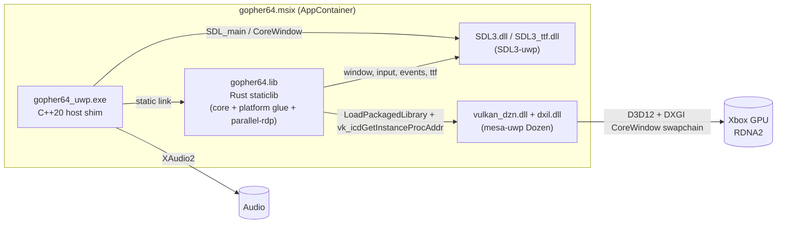

# Gopher64 on Xbox Series (Dev Mode / UWP) — Port Plan

> **Status:** Planning — no code changes yet.
> **Plan date:** 2026-10-28
> **Upstream base:** `gopher64/gopher64@87385e7` (v1.1.42)
> **Fork:** `marcelofrau/gopher64`
> **Target:** Xbox Series X|S in Developer Mode, packaged as a UWP `.msix`.

This folder is the single source of truth for the Xbox port. It records **what** we are going to build, **why** each decision was made, **what can go wrong**, and **the checklist we follow**. Every document is meant to be updated as work progresses — when a decision changes, edit the decision record and leave a dated note rather than silently rewriting history.

---

## TL;DR

Gopher64 is a Rust N64 emulator with a C++ Vulkan renderer (parallel-rdp). Xbox Dev Mode only allows UWP apps (CoreWindow, AppContainer, D3D11/D3D12 only — **no native Vulkan driver**). The plan is:

1. **Keep the emulator core untouched.** It is a pure interpreter (no JIT, no `mmap`/`VirtualAlloc`), so it has no UWP-hostile code.
2. **Compile the Rust crate as a static library** for the Tier-3 target `x86_64-uwp-windows-msvc` (upstream's pinned rustc + `RUSTC_BOOTSTRAP=1` + `-Z build-std`), with `--no-default-features` (drops slint/winit/wgpu/rfd/open).
3. **Host it in a thin C++20 UWP executable** that uses SDL3-uwp's `SDL_main` (same pattern as our Ymir port) and calls into Rust through a C ABI entry point (modelled on the existing Android `gopher64_sdl_main`).
4. **Run Vulkan through Mesa Dozen** (Vulkan → D3D12, `vulkan_dzn.dll` from our `mesa-uwp` fork), loaded directly with `LoadPackagedLibrary`, bypassing the Khronos loader. parallel-rdp requires Vulkan 1.1, compute, a swapchain and 8/16-bit storage buffer access ([04 §2](04-vulkan-dozen.md#2-what-parallel-rdp--granite-actually-require)). Dozen-on-Xbox is already proven by shipped projects (OnyxEMU, rpcs3-xbox, gow3_xbox, WWHD-UWP — October 2026); we adopt their Xbox-specific Mesa fixes (write-combined memory, DXIL self-signing, PSO cache).
5. **Replace the few SDL subsystems that are broken on Xbox**: audio → XAudio2 (SDL WASAPI deadlocks on Xbox), Vulkan surface → custom Granite `WSIPlatform`, paths → LocalState / external drive.
6. **Package, sign and deploy** with the scripts we already proved on Ymir, dosbox-pure and scummvm.
7. **De-risk first**: Phase 0 validates parallel-rdp on Dozen **on a Windows PC** before any Xbox work.

---

## Document index

> **Start here:** [00 — Upstream fidelity rules](00-upstream-fidelity-rules.md) are **mandatory** for every change. The port is an additive layer on top of upstream so that every upstream release merges with minimal friction.

| # | Document | What it covers |
|---|----------|----------------|
| 00 | [**Upstream fidelity rules**](00-upstream-fidelity-rules.md) | Binding rules (R1–R11) that keep the fork mergeable with upstream; hook inventory; diff budget; PR checklist |
| 01 | [Context & goals](01-context-and-goals.md) | Goals, non-goals, Xbox Dev Mode constraints, success criteria |
| 02 | [Architecture](02-architecture.md) | Component, build, runtime, threading, boot and frame diagrams; repo layout |
| 03 | [Decision records](03-decisions.md) | Every architectural decision (D-01…), alternatives considered, rationale |
| 04 | [Vulkan via Dozen](04-vulkan-dozen.md) | parallel-rdp/Granite requirements vs Dozen features, ICD loading, WSI, RDRAM coherency |
| 05 | [Rust on UWP](05-rust-uwp-toolchain.md) | Tier-3 target, build-std, spike evidence, crate compatibility matrix, cfg gating plan |
| 06 | [Platform layer](06-platform-layer.md) | SDL3-uwp, window, audio (XAudio2), input, storage, logging, lifecycle, timing |
| 07 | [Frontend / launcher](07-frontend.md) | How the user picks ROMs and settings on a TV with a gamepad |
| 08 | [Packaging & deployment](08-packaging-deploy.md) | Manifest, capabilities, msix, signing, Device Portal deploy, CI |
| 09 | [Risk register](09-risks.md) | Ranked risks, probability/impact, mitigations, kill criteria |
| 10 | [Roadmap & checklist](10-roadmap-checklist.md) | Phases P0–P6 with tasks, exit criteria and checkboxes |
| 11 | [Prior art](11-prior-art.md) | What the workspace ports and the Xbox homebrew scene already solved |
| 12 | [Upstream sync & branching](12-upstream-sync.md) | How we stay mergeable with `gopher64/gopher64` |
| 13 | [Testing & debugging](13-testing-debugging.md) | Test matrix, logging, diagnostics, performance metrics |

---

## Conventions

| Prefix | Meaning | Where |
|--------|---------|-------|
| `D-xx` | Decision record | [03-decisions.md](03-decisions.md) |
| `R-xx` | Risk | [09-risks.md](09-risks.md) |
| `P0`…`P6` | Roadmap phase | [10-roadmap-checklist.md](10-roadmap-checklist.md) |
| `Q-xx` | Open question (to be answered by a spike/test) | Inline, collected in [10-roadmap-checklist.md](10-roadmap-checklist.md#open-questions) |

- File references use `path:line` against upstream `87385e7` unless stated otherwise. Line numbers drift; treat them as pointers, not contracts.
- "Workspace" means the **parent directory of this repository** (`..`). Sibling repositories are referenced relative to the repo root, e.g. `../Ymir`, `../mesa-uwp`, `../SDL3-uwp`; bare names like `Ymir` mean the same sibling. No absolute machine paths are used anywhere, so the setup moves between machines unchanged.
- **Verified** = checked in source or by running something. **Inferred** = reasoned from documentation/code but not executed. Docs mark inferred facts explicitly.

## Key facts at a glance

| Topic | Fact | Evidence |
|-------|------|----------|
| CPU core | Pure interpreter, SSE/SSSE3/SSE4.1 intrinsics, no JIT / no executable memory | `src/device/cpu.rs`, `src/device/rsp_vu_instructions.rs` |
| Renderer | parallel-rdp (Vulkan compute) + Granite Vulkan backend + volk | `build.rs:16-82` |
| Vulkan entry | `Context::init_loader(SDL_Vulkan_GetVkGetInstanceProcAddr())` | `parallel-rdp/interface.cpp:430` |
| Hard Vulkan needs | Vulkan 1.1, graphics+compute queue, `VK_KHR_swapchain` (+ `create_renderpass2` if < 1.2) | `vulkan/context.cpp:918,1085,1428` |
| Required Vulkan storage | 8/16-bit storage buffer access; 8/16-bit arithmetic is optional | `rdp_renderer.cpp:168-177,213-225` |
| Optional Vulkan needs | timeline semaphores, subgroups, `VK_EXT_external_memory_host` | `rdp_device.cpp:75-111`, `rdp_renderer.cpp:228-250`, `device.cpp:1066` |
| Dozen | Vulkan 1.2, timeline ✔, subgroups ✔ (if WaveOps), 16-bit ✔ (if native 16-bit), 8-bit off by default, ext-mem-host only with `ID3D12Device13` | `mesa-uwp/src/microsoft/vulkan/dzn_device.c:61-149,668-800,986` |
| Dozen UWP WSI | `VK_KHR_win32_surface` → `CreateSwapChainForCoreWindow`, extent from HDMI mode | `mesa-uwp/src/vulkan/wsi/wsi_common_win32.cpp:210,925` |
| Dozen DLL exports | `vk_icdGetInstanceProcAddr`, `vk_icdGetPhysicalDeviceProcAddr`, `vk_icdNegotiateLoaderICDInterfaceVersion`; App CRT | `dumpbin` of RetroArch's bundled `vulkan_dzn.dll` |
| SDL3-uwp | No Vulkan in the WinRT video driver; `SDL_WINDOW_VULKAN` makes `SDL_CreateWindow` fail | `SDL3-uwp/src/video/SDL_video.c:2678` |
| Rust UWP | `x86_64-uwp-windows-msvc` staticlib builds with nightly + `-Zbuild-std=std,panic_abort` (~50 s) | Spike, 2026-10-28 |
| Toolchain on this PC | VS 18 BuildTools (MSVC 14.51, `lib/x64/store`), SDK 10.0.26100 (`WindowsApp.lib`), nightly + 1.99.1 with `rust-src` | Local check, 2026-10-28 |
| Rust UWP on upstream toolchain | `RUSTC_BOOTSTRAP=1 cargo +1.99.1 build -Zbuild-std=std,panic_abort --target x86_64-uwp-windows-msvc` ✔ (39 s) | Spike, 2026-10-28 |
| Dozen on Xbox in the wild | ≥ 5 shipped projects since 2026-10-04 (OnyxEMU first); none is an N64 / parallel-rdp user | [11](11-prior-art.md) |
| Xbox Dozen pitfalls | CPU writes via WRITE_BACK mappings invisible to GPU; Series S DXIL validator rejects Dozen shaders; PSO compile 0.4–0.7 s | OnyxEMU Mesa patches `0014`, `0008`/`0016`, `0017` |
| Desktop-only APIs in Granite/volk | `LoadLibraryA` (`volk.c:87`, `context.cpp:249`), `MessageBoxA` (`breadcrumbs.cpp:709`) | grep of the 44 compiled files |
| Blocking crate | `spin_sleep` imports `timeBeginPeriod` (winmm) → replace on UWP | `spin_sleep-1.3.3/src/windows.rs:4-17` |
